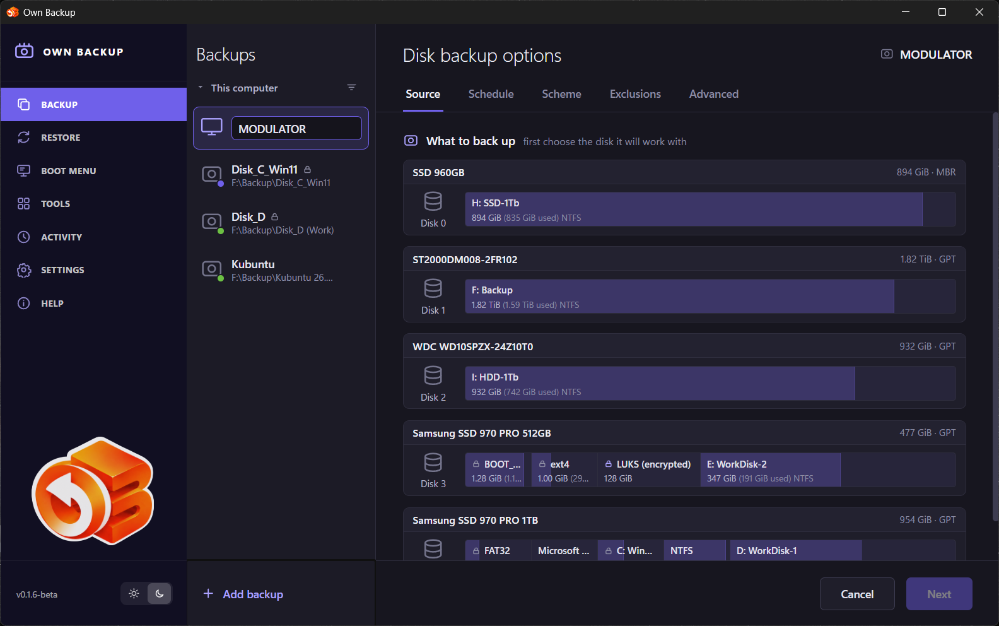

# Quick start

This page makes a first backup of the system disk, checks it and builds the
boot medium — the three things worth doing on the day the program is installed.

## 1. Create a job

Open **Backup** and click **Add backup**. The job wizard opens on the
**Source** step and first asks which disk the job works with.

1. Click the disk the system is on. Its partitions appear; tick the ones to
   copy. For a disk that should boot after a restore, tick **Bootable disk
   backup** — it selects every partition the system needs (EFI, the system
   partition, recovery).
2. Under **Where to save**, choose a folder on another disk — an external USB
   disk is the usual choice. The file name is filled in for you.
3. Click **Next** through the steps, or jump to any of them by its tab:
   - **Schedule** — for example *Weekly* on chosen days and time, or *Do not
     schedule* to run it by hand;
   - **Scheme** — the format (*OBK* to encrypt), the compression level and the
     backup method (*Incremental* is a good start);
   - **Exclusions** — the default list already leaves out the page file,
     hibernation file, recycle bin and temporary folders;
   - **Advanced** — validation after the backup, retries, what to do after.
4. Click **Save**. With OBK the program asks for a password and then shows a
   **recovery key** — save it somewhere other than the backup disk.

The details of every step are in [Backup](05-backup.md).

## 2. Run it

Select the job and click **Back up now**. The page shows the phases — finding
files to exclude, copying, removing excluded files from the image, validating
— with the speed and the time left.

You can close the window: the service carries on, and the tray icon shows that
a backup is running. When it ends, the job page shows the result.

## 3. Check it

A backup you have not checked is a hope, not a backup.

- If **Validate the backup after it is made** is on (the default), the run
  already read every block back and compared its checksum.
- To look inside, choose **Mount as a disk…** in the job's menu (the **⌄**
  button next to its name): the backup's partitions appear as drives, read-only,
  and you can open files. Unmount it under **Tools** when done.
- The real test is a restore to a spare disk or a virtual machine — see
  [Restore](06-restore.md).

## 4. Build the boot medium

The system disk cannot be restored while the system runs from it. Build the
boot medium now, while the computer works: **Tools → Bootable media**, then
write the ISO to a USB stick. See [Bootable media](10-bootable-media.md).
