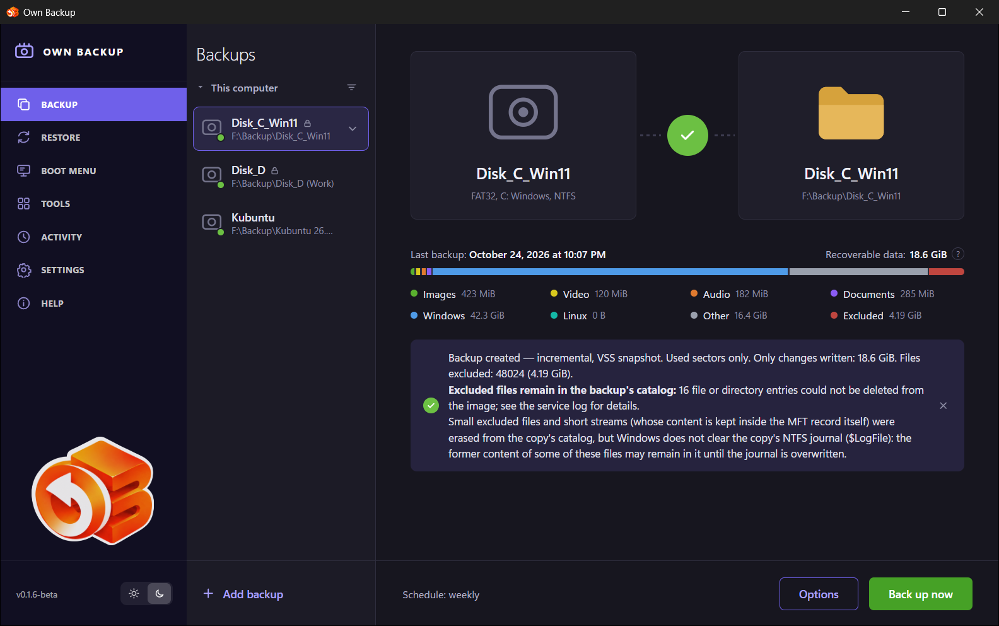
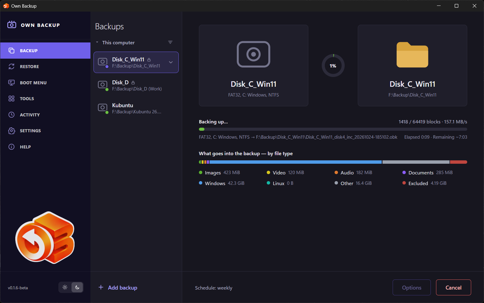
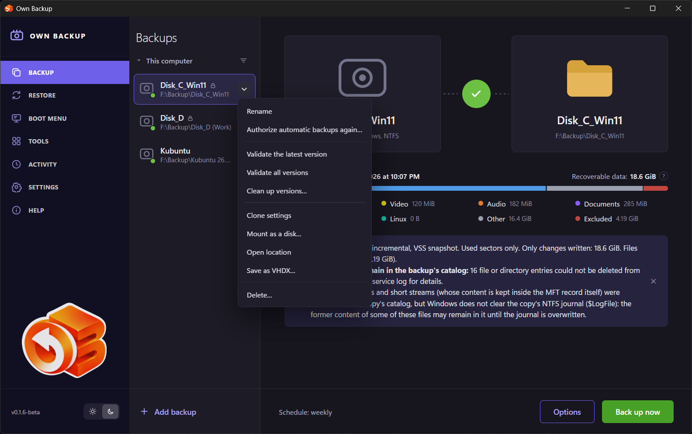
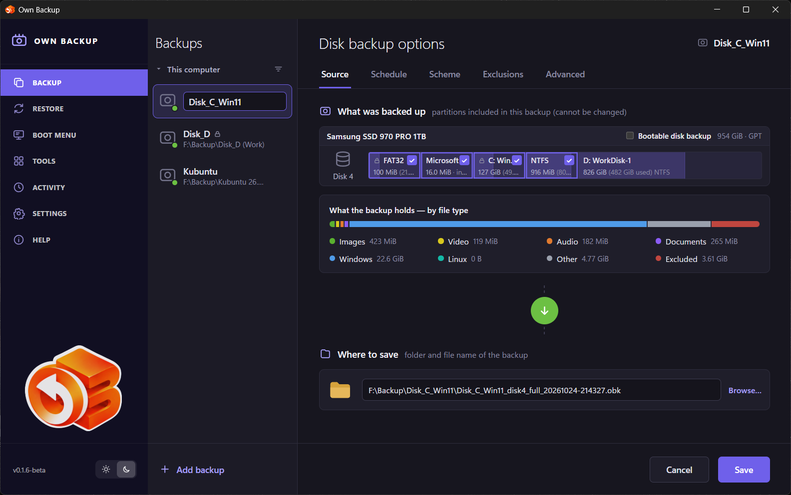
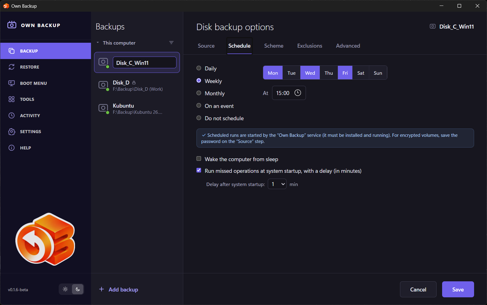
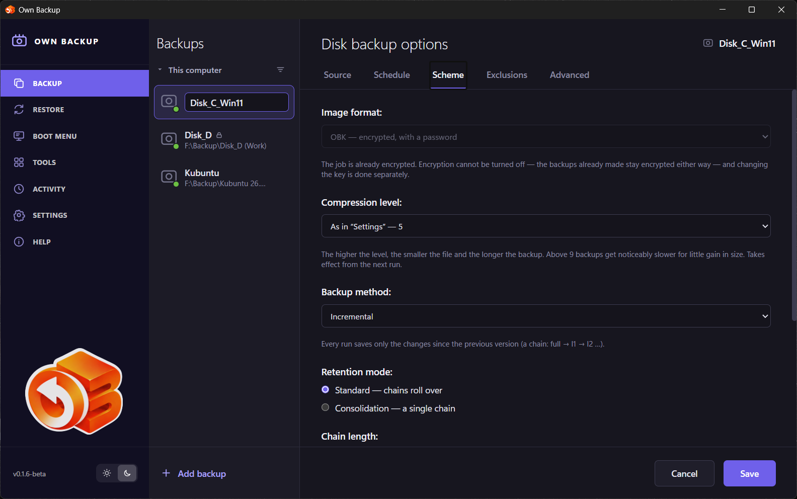
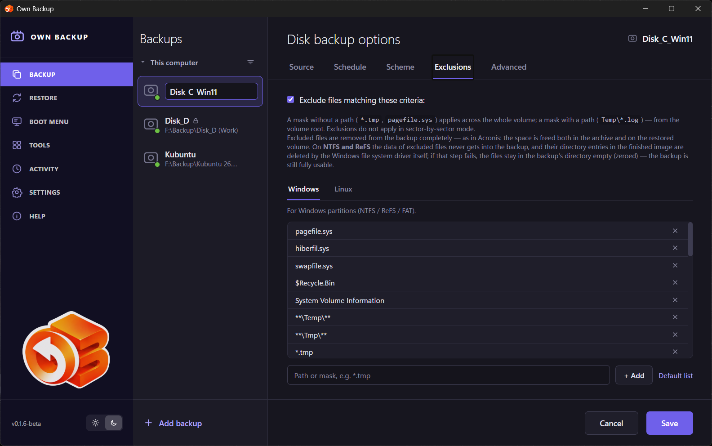
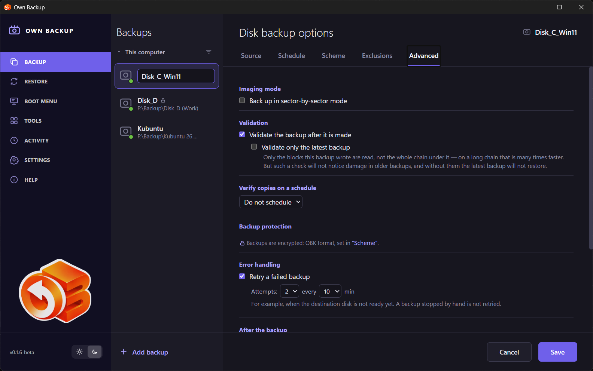

# Backup

The **Backup** page is where jobs are created, run and watched.

## The job list

The middle column lists the jobs of **This computer**. Each shows its name, its
destination folder and a coloured dot: green — the last run succeeded, red — it
failed, violet — running now. A lock icon marks an encrypted (OBK) job. The
**Sort** button above the list changes the order.

**Add backup** at the bottom starts the job wizard.

## The job page

Selecting a job shows:

- **Source and destination** — what the job backs up (its partitions) and the
  folder it writes to. The circle between them shows the progress of a run,
  or the result of the last one.
- **Last backup** — when the last version was made.
- **Recoverable data** — how much a restore of the latest version brings back.
- **What the backup holds — by file type** — images, video, audio, documents,
  Windows, Linux, other, and what was excluded. The breakdown is counted while
  the files are scanned, before the copy.
- **The result of the last run** — the kind of backup (full, incremental,
  differential), how it was read (VSS snapshot, used sectors only), how much
  was written, how many files were excluded, and notes, for example excluded
  files that stayed in the catalog. The **×** hides it.
- **Schedule** — at the bottom, with **Options** (the job wizard) and **Back up
  now**.

### A run

**Back up now** starts the job at once. The page then shows the phase:

| Phase | What happens |
|---|---|
| *Preparing: finding files to exclude…* | The file system is read to find excluded files and to count the data by type. |
| *Backing up…* | Blocks are copied; the speed, the blocks done and the time left are shown. |
| *Finishing: releasing the volume snapshot…* | The image is written; the snapshot is released. |
| *Removing excluded files from the image…* | The names of excluded files are deleted inside the finished image (it is first opened — on Windows attached as a disk). |
| *Finishing: writing the image to disk…* | The image is flushed and published under its real name. |
| *Validating this backup…* / *Validating all backups…* | With validation on: every block is read back and checked. |

**Cancel** stops the run; nothing of it is kept, earlier versions are not
touched. When nothing has moved for several minutes the page says so and what
usually causes it.

## The job's menu

The **⌄** button next to a job's name opens its menu.

| Item | What it does |
|---|---|
| **Rename** | Changes the name in the list. The files on disk keep their names, and the chain carries on. |
| **Authorize automatic backups again…** | For an encrypted job whose key the service can no longer open by itself (reinstalled system, another computer): enter the password or the recovery key once, and scheduled runs work again. |
| **Validate the latest version** | Reads the latest version and its chain and checks every block. |
| **Validate all versions** | The same for every version in the folder. |
| **Clean up versions…** | Lists the versions by chain, with type and size. Tick what to delete; a version built on a ticked one goes with it, since it cannot be read without it. The files are deleted for good. |
| **Clone settings** | Opens the wizard with a copy of this job's settings for a new job. |
| **Mount as a disk…** | Attaches a chosen version as a disk, read-only by default, to copy files out of it. See [Tools](08-tools.md#mount-image-as-a-disk). |
| **Open location** | Opens the job's folder in the file manager. |
| **Save as VHDX…** | Saves the disk as of a chosen version as one VHDX file — no chain, no compression, no encryption — that Windows and any virtual machine open without Own Backup. For an encrypted job the saved file is not encrypted. |
| **Delete…** | Deletes the job after a confirmation. With **Delete all related files** ticked, its backup files are deleted from the disk too; otherwise they stay. |

## The job wizard

**Add backup** and **Options** open the same wizard, with five steps. The tabs
at the top switch between them; **Save** (or **Back up now** for a new job)
keeps the job, **Cancel** leaves without changes.

### Source

- **What to back up.** First the disk: the wizard shows every disk with its
  partitions drawn to scale. Click one, then tick the partitions. **← another
  disk** goes back to the list. A job works with one disk.
- **Bootable disk backup** ticks what the system boots from — the EFI
  partition, the boot loader partition, the system partition — so the restored
  disk starts. Data partitions are left to you. A partition without a file
  system (Microsoft reserved, for one) goes into the backup as its partition
  table entry only.
- **Encrypted volumes** (BitLocker, LUKS) ask for their password or 48-digit
  recovery key; **Unlock** checks it. **Shared password** unlocks several
  volumes with one. **Remember** stores it (protected by the system) so that
  scheduled runs can open the volume — without it a scheduled run is skipped.
  A volume left locked is not backed up at all.
- **What the backup holds — by file type** shows the data that will go in.
- **Where to save** — the folder and the file name. The destination must not be
  on a disk being backed up; the wizard refuses it.

An existing job shows its source as **What was backed up** — it cannot be
changed, because the versions already made must stay one chain.

### Schedule

- **Daily**, **Weekly** (days of the week), **Monthly** (day 1–28), **At** a
  time; **On an event**; or **Do not schedule** (run by hand).
- Events: **When the disk the backup is written to is connected** (the backup
  starts within 10 seconds after the disk appears), **When a user signs in**,
  **When a user signs out**, **At system startup (with a delay)**. **Only once a
  day** keeps an event from running the job again the same day.
- **Wake the computer from sleep** — the computer wakes a minute before the
  run. Wake timers must be allowed in the power plan.
- **Run missed operations at system startup, with a delay** — a run missed while
  the computer was off happens after the next start.

### Scheme

- **Image format:** *VHDX — the Windows standard (default)*, *qcow2 —
  universal, compressed*, *OBK — encrypted, with a password*. OBK asks for a
  **Backup password** twice. The format of a job with backups cannot be
  changed, and encryption cannot be turned off.
- **Compression level** (qcow2 and OBK): *As in "Settings"* or 1–19.
- **Backup method:** *Full*, *Incremental*, *Differential* — see
  [Concepts](03-concepts.md#versions-and-chains).
- **Retention mode:**
  - *Standard — chains roll over:* **Chain length** — *make at most N
    incremental versions per chain*, then a new full backup starts a new chain;
    **Cleanup rules for old chains** — keep no more than N latest chains,
    delete chains older than N days, do not delete the first (oldest) chain.
    A chain is deleted whole, and only after the next backup has succeeded.
  - *Consolidation — a single chain:* **Consolidate after N incremental
    versions** — the oldest version is merged into the full backup. The full
    backup then no longer shows the day it was made. **Chain refresh** —
    *start the chain over when it is older than N days*: a new full backup is
    made first, then the old chain is deleted.
  - With *Full*: **Cleanup rules for old backups** — keep the latest N, delete
    backups older than N days, keep the first.

### Exclusions

- **Exclude files matching these criteria** turns the rules on.
- Two lists: **Windows** (NTFS, ReFS, FAT) and **Linux** (ext, XFS, btrfs;
  masks from the volume root, e.g. `var/cache/**`).
- Type a path or a mask and click **Add**; **×** removes a mask; **Default
  list** restores the defaults (page file, hibernation file, swap file, recycle
  bin, System Volume Information, temporary folders and files, browser and
  system caches).

How exclusions work is in [Concepts](03-concepts.md#exclusions).

### Advanced

- **Imaging mode — Back up in sector-by-sector mode:** every sector, used or
  not; exclusions do not apply.
- **Validation — Validate the backup after it is made**, and **Validate only
  the latest backup** (reads only the blocks this run wrote — much faster on a
  long chain, but does not notice damage in older versions).
- **Verify copies on a schedule:** a recurring check of the latest version (or
  **all versions**); results appear in **Activity**. It gives way to anything
  you start on the same folder.
- **Backup protection** — whether the backups are encrypted (set in *Scheme*).
- **Error handling — Retry a failed backup:** *Attempts* and *every N min* — for
  a destination that is not ready yet. A backup stopped by hand is not retried.
- **After the backup:** *Do nothing*, *Put the computer to sleep* (a minute
  after it finishes), *Shut down the computer* (with a warning a minute and a
  half ahead; `shutdown /a` on Windows or `shutdown -c` on Linux cancels it).
  Only when no other backups are queued.
- **Performance — Low priority — stay out of the way** (other programs get the
  disk and processor first) and **Limit the read speed** (MB/s).

The computer does not go to sleep while a backup or a restore runs.
