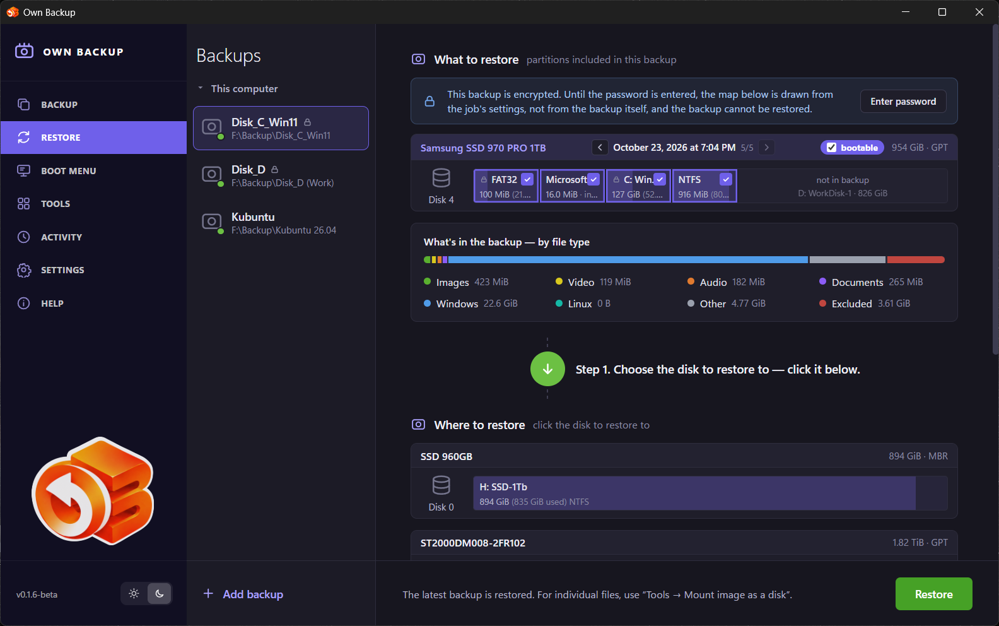

# Restore

The **Restore** page writes a backup back onto a disk: whole (partition table,
boot data and every partition) or partition by partition. To get individual
files back, mount the backup instead — see [Tools](08-tools.md#mount-image-as-a-disk).

## Choosing the backup

The middle column lists the backups of **This computer** — one entry per job,
with the number of versions. To restore a backup that is not in the list (made
on another computer, copied from elsewhere), click **Add backup** and choose a
**File** (a single image) or a **Folder with backups** (every backup in it).
With **Add the backup file(s) to the Backups list** it stays in the list after a
restart. The icon beside **This computer** changes the order of the list. The
arrow in a row or a right click opens the same menu as in **Backup**; a backup
added by hand has a shorter one: checking and mounting (on the **Tools** page),
**Open storage** and removing it from the list. A backup added this way can be
removed from the list later; its files
are not deleted.

## What to restore

The top part shows the disk as it was in the backup, partition by partition,
with **What's in the backup — by file type**. The arrows next to the date step
through the versions (**Older backup**, **Newer backup**); the latest is
selected by default.

An **encrypted** backup shows the map from the job's settings until its
password is entered (**Enter password**). Only then can it be restored — and
the page shows whether the partitions come back encrypted.

## Where to restore

1. **Step 1. Choose the disk to restore to** — click it in **Where to
   restore**. The disk the running system is on is not offered: restore it
   from the [boot medium](10-bootable-media.md).
2. **Step 2.**
   - For a **bootable** (whole-disk) backup: click the free (unallocated) space
     — every partition of the backup goes there, with the boot data.
   - For individual partitions: click a partition above (it turns yellow),
     then the partition below to copy it to.
3. **Step 3.** Repeat for the other partitions and click **Restore**, or
   **Cancel** to start over. **Undo the last action** steps back.

Free space and partitions on the target disk can be edited first: click free
space to **Create partition** (size, file system, type, label, drive letter,
quick format); right-click a partition to **Extend partition**, **Delete
partition** or **Add to partition**. Nothing is written until the plan is
confirmed.

A partition is restored block by block when the target is at least as big; onto
a smaller target the data is copied file by file. A disk with a different
sector size (512 vs 4096 bytes) can take individual partitions, but not a
bootable backup.

## Checking the plan and restoring

**Restore** opens **Restore plan check**: the service checks the plan and lists
**The following operations will be performed**. Options:

- **Wipe free space** — also zero the gaps between used blocks (only used
  blocks are copied, so the old data physically stays in the gaps otherwise).
  Takes longer.
- **Verify the written data after the restore** — read back what was written.
- **Duplicate identities** (Linux, when the original disks are still in the
  machine): *Keep them as they are*, *Change them on the restored copy*, or
  *Change them and fix the restored system's fstab, crypttab and boot loader*.
  Two file systems with the same UUID confuse the system that sees both.
- **Put encryption back on partition N** — for a LUKS partition whose container
  header is in the backup: the partition comes back encrypted with the same
  UUID and password. Without it the partition holds a plain file system.

If the backup holds the computer's **boot entries** (a bootable backup), the
program asks **Restore the boot entries?** — the entries the firmware offers at
power-on live in the motherboard's memory, not on the disk. The current entries
are saved to a file first.

The last step is **Confirm restore**: type **YES** (in capitals) to continue.
There is no undo — everything on the affected partitions is replaced.

During the restore the page shows the progress; at the end, **What is left to
do**, if anything (for example a rebuilt initramfs on Linux, or reconnecting a
BitLocker volume).

## Encrypted partitions

- **LUKS:** a backup keeps the container header; with **Put encryption back**
  the partition is restored as it was. Without it, Linux will not boot from that
  partition (initramfs and `/etc/crypttab` expect a container).
- **BitLocker:** the partition comes back **decrypted** — Windows boots from it
  fine, but turn BitLocker on again in Windows if the disk should be encrypted.

## Restoring the system disk

1. Boot the computer from the [boot medium](10-bootable-media.md).
2. Open **Restore**, add the backup (**Add backup → Folder with backups**) if
   it is not listed, choose the version and the target disk.
3. Restore, answer **Restore the boot entries?**, remove the medium and
   restart.
