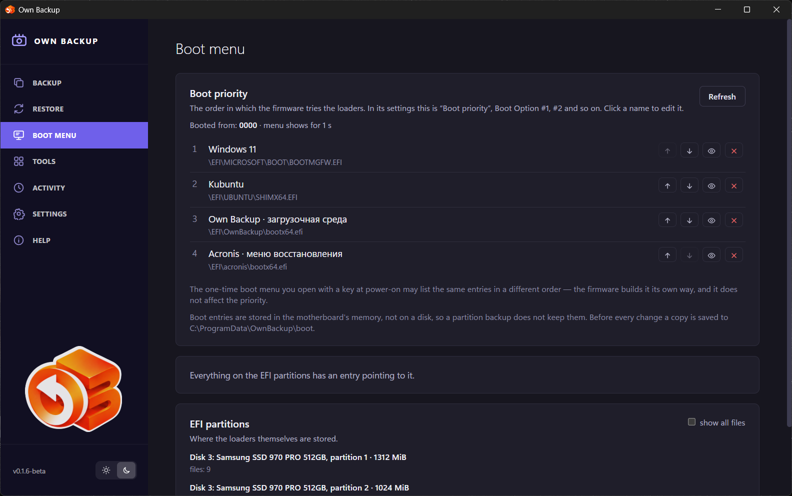

# Boot menu

The **Boot menu** page shows and edits the computer's **UEFI boot entries** —
the list the firmware works through at power-on. These entries live in the
motherboard's memory, not on a disk, so a partition backup does not hold them
(a bootable whole-disk backup records them separately, see
[Restore](06-restore.md)).

## Boot priority

The order in which the firmware tries the loaders — in its own settings this is
*Boot priority*, *Boot Option #1, #2…*. Above the list:

- **Booted from** — the entry the system started from now;
- **menu shows for N s** — the firmware's boot menu timeout;
- **next boot, once only** — when an entry is set for the next start only.

Each entry shows its name and the loader file. The buttons on the right:

| Button | What it does |
|---|---|
| ↑ / ↓ (**Move up**, **Move down**) | Changes the order. |
| 👁 (**Hide from the menu** / **Show in the menu**) | Keeps the entry but takes it out of the order — the firmware does not offer it. |
| × (**Delete entry**) | Deletes the entry. The loader file stays on the partition. |

Click a name to **Rename** the entry. Entries that are not fully understood,
or that point to a device rather than a file, cannot be edited.

**Before every change the current entries are saved to a file** in the
program's `boot` folder, so a change can be undone by hand.

The one-time boot menu you open with a key at power-on may list the same
entries in a different order: the firmware builds it its own way, and it does
not affect the priority.

## Loaders without an entry

Files on the EFI partitions that no entry points to. **Add to menu** creates an
entry for one (you give it a name). When every loader has an entry the page
says *Everything on the EFI partitions has an entry pointing to it*.

## EFI partitions

Where the loaders are stored: each EFI partition of each disk, with its size
and loaders. **show all files** lists every file, not only the loaders. Each
loader is marked by its state: *entry N*, *removable-media fallback path*,
*started by another loader*, *no entry*.

## Notes

- A computer that does not boot through UEFI (legacy BIOS) has no such entries;
  the page says so.
- The names of entries are stored in the firmware as they were written. An
  entry the program created while its language was Russian keeps its Russian
  name until you rename it.
- On Linux the page needs the `boot-config` polkit permission for changes; the
  same can be done with `efibootmgr`.
