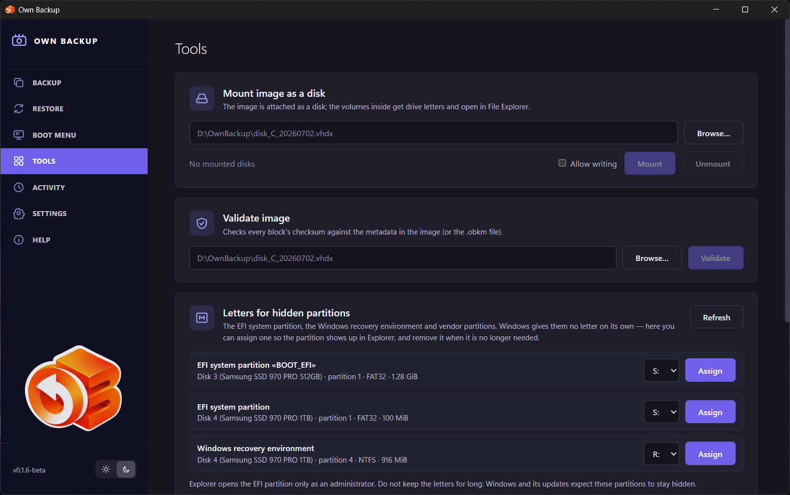
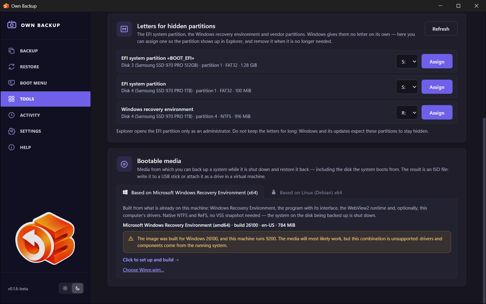

# Tools

## Mount image as a disk

Attaches a backup image as a disk so its contents can be opened and files
copied out — the way to restore individual files.

1. Type the path of an image or click **Browse…** (`.vhdx`, `.avhdx`, `.qcow2`,
   `.obk`). An incremental version is mounted together with its chain.
2. Leave **Allow writing** off unless you need it: a read-only mount cannot
   change the backup.
3. Click **Mount**. An encrypted (OBK) backup asks for its password or recovery
   key first.

On **Windows** the image is attached through Windows' own iSCSI initiator (no
third-party driver is installed); its volumes get drive letters and open in
File Explorer. On **Linux** the image is served through the kernel's NBD
device, read-only, and its volume is mounted into a folder.

The list below shows what is mounted; **Unmount** detaches the selected image.

The same is reachable from a job: **⌄ → Mount as a disk…** lets you choose the
version.

## Validate image

Checks every block of an image against the checksums stored in it. Choose the
image and click **Validate**; an incremental version is checked with its
chain. The result is either *Integrity confirmed: N blocks in S s* or *The
backup is damaged: checksums do not match for N of M blocks*. The progress
bar and the result stay if you leave the page and come back.

## Letters for hidden partitions

Windows gives no drive letter to the EFI system partition, the Windows recovery
environment or vendor partitions. Here you can **Assign** a letter so the
partition shows up in Explorer, and **Remove letter** when done. Explorer opens
the EFI partition only as an administrator. Do not keep the letters for long:
Windows and its updates expect these partitions to stay hidden. (Windows only.)

## Bootable media

Builds the boot medium — a system that starts from a USB stick or a CD with the
program on it, to restore the system disk or back up a computer that does not
start. Two kinds:

- **Based on Microsoft Windows Recovery Environment (x64)** — built on Windows
  from what is already on the machine: the Windows Recovery Environment, the
  program, the WebView2 runtime and, optionally, this computer's drivers.
- **Based on Linux (Debian) x64** — a small Debian system with the program; it
  reads ext4, btrfs, XFS and LUKS directly and restores Windows backups too.
  On Linux it is built from the installed package or downloaded ready from the
  release; on Windows the ready ISO of this version is downloaded from the
  release.

Details, writing to a USB stick and working from the medium are in
[Bootable media](10-bootable-media.md).

## Linux partitions in Total Commander (Windows)

A Total Commander plugin shows the files of this computer's Linux partitions:
ext2/3/4, also inside LVM and encrypted LUKS (the way Ubuntu installs with disk
encryption). The partition is read in place and **read-only**: nothing is
mounted or taken offline, and the other partitions of the same disk (a Windows
data drive, say) keep working. The Own Backup service does the reading, so it
must be installed and running.

**Add the plugin** (once): in Total Commander 64-bit — **Configuration →
Options → Plugins → File system plugins (.WFX) → Configure → Add**, and choose
`C:\Program Files\OwnBackup\TotalCommander\OwnBackup.wfx64`.

**Use it:** open **Network Neighborhood** (`\\\`) → **Own Backup Linux**. It
lists partitions such as "Disk 3 · partition 3 · 128 GB · LUKS". For an
encrypted one Total Commander asks for its encryption passphrase; with LVM
inside, its volumes appear (`vgubuntu-root`), swap is not shown. Files are
copied (F5), viewed (F3) and opened (Enter) as usual; nothing on the partition
can be changed, deleted or moved.

- Characters Windows does not allow in names (`: ? * " < > |`) and names that
  are not UTF-8 are shown with substitute characters, as WSL does; files are
  copied under those names.
- Symbolic links are shown as what they point to; special files (devices,
  sockets) are not shown.
- If Linux was not shut down cleanly, the filesystem journal is taken into
  account while reading (in memory; nothing is written to the disk).
- The passphrase is kept in Total Commander's memory until it closes: after
  half an hour idle the partition is reopened without asking again.
