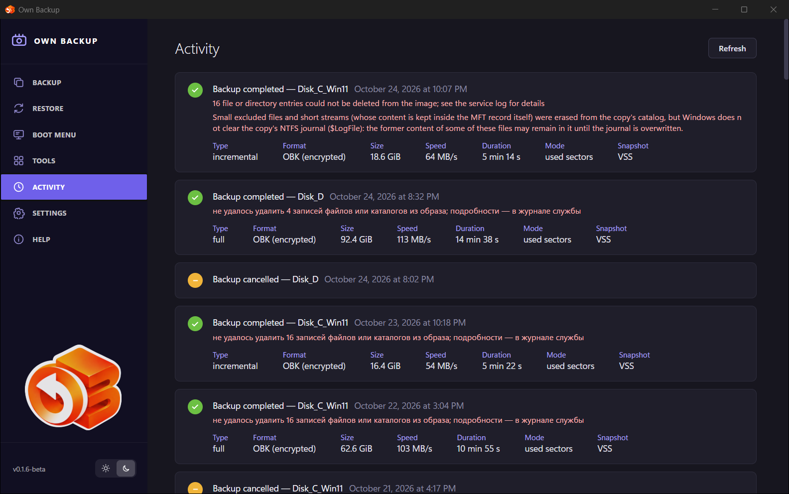
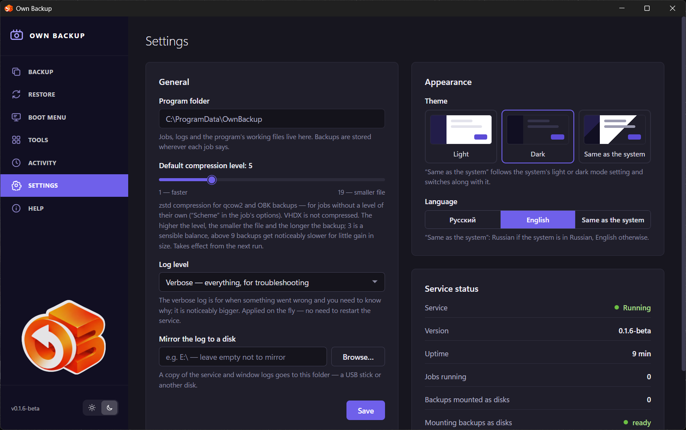
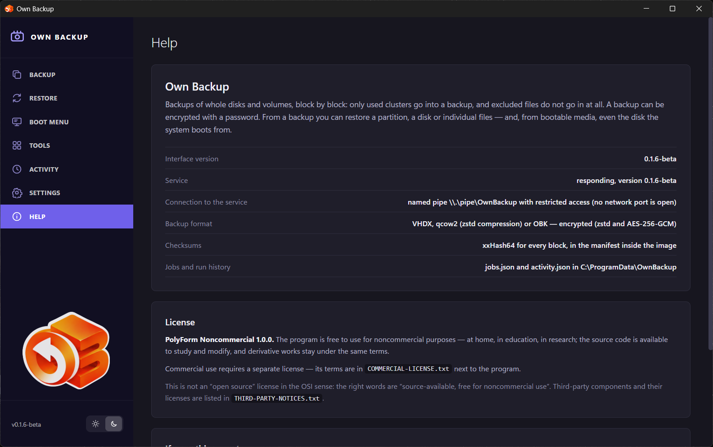

# Activity, Settings, Help

## Activity

The history of backups, restores and scheduled checks, newest first.
**Refresh** reloads it. Each entry shows its result and time:

- *Backup completed*, *Backup failed*, *Backup cancelled*, *Backup interrupted*
  (the service was stopped during the run — the schedule repeats it), *Scheduled
  backup not started* (for example a password is not saved);
- *Restore completed*, *Restore failed*, *Restore cancelled*;
- *Copies verified*, *Verification failed*, *Verification cancelled*.

Under it: notes and errors in red, and the details — **Type** (full,
incremental, differential), **Format**, **Size**, **Speed**, **Duration**,
**Mode** (*used sectors* or *sector-by-sector*), **Snapshot** (*VSS*, an LVM or
device-mapper snapshot, or *not needed (offline)* on the boot medium). A restore
shows the target disk and **Operations** done of planned, and **Still to do**
if something is left.

The history keeps the last 200 runs. Its notes stay in the language the program
spoke at the time of the run.

## Settings

### General

- **Program folder** — where jobs, logs and working files live (shown, not
  changed here).
- **Default compression level** — 1 (faster) to 19 (smaller file), for qcow2
  and OBK jobs without a level of their own. Takes effect from the next run.
- **Log level** — *Normal — progress and errors* or *Verbose — everything, for
  troubleshooting*. Applied at once.
- **Mirror the log to a disk** — a copy of the service and window logs goes to
  this folder (a USB stick, another disk): it survives even if a restore takes
  away the disk the logs were on.

**Save** applies the general settings. The service writes them, so no
administrator prompt is needed.

### Appearance

- **Theme** — *Light*, *Dark*, *Same as the system*. The sun and moon buttons
  at the bottom of the menu switch it too.
- **Language** — *Русский*, *English*, *Same as the system* (Russian if the
  system is in Russian, English otherwise). Applied at once, without a restart.

### Service status

Whether the service runs, its **Version**, **Uptime**, **Jobs running**,
**Backups mounted as disks**, and whether **Mounting backups as disks** is
ready (iSCSI on Windows; NBD and ntfs-3g on Linux).

### Icon in the notification area

Whether the tray icon is shown. The icon appears when you sign in and while the
service runs; its tooltip says *Own Backup — the service is running*. Clicking
it opens the window; its menu has **Open Own Backup** and **Hide the icon**.

## Help

- The program's description, **Interface version** and **Service** version, the
  **Connection to the service** (named pipe or Unix socket, no network port),
  the **Backup format**, **Checksums**, and where **Jobs and run history** are
  kept.
- **License** — PolyForm Noncommercial 1.0.0, what it allows, where the
  commercial terms and third-party notices are.
- **If something went wrong** — where the history and logs are, the log
  mirror, and the boot medium for a system that does not start.
