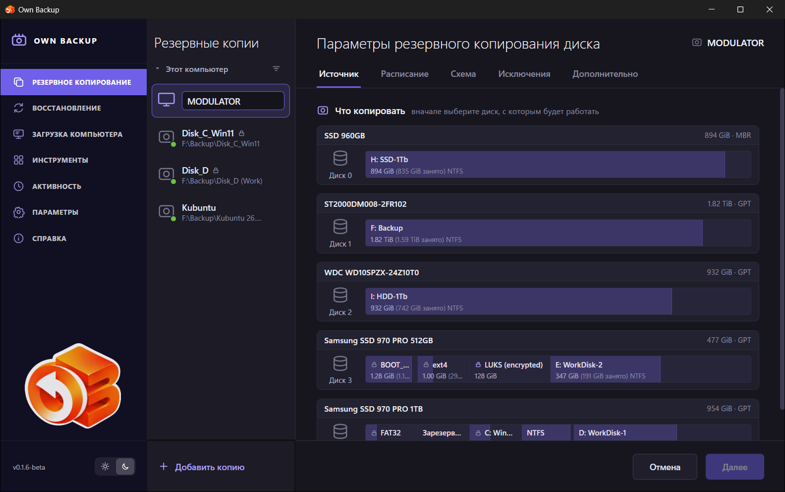
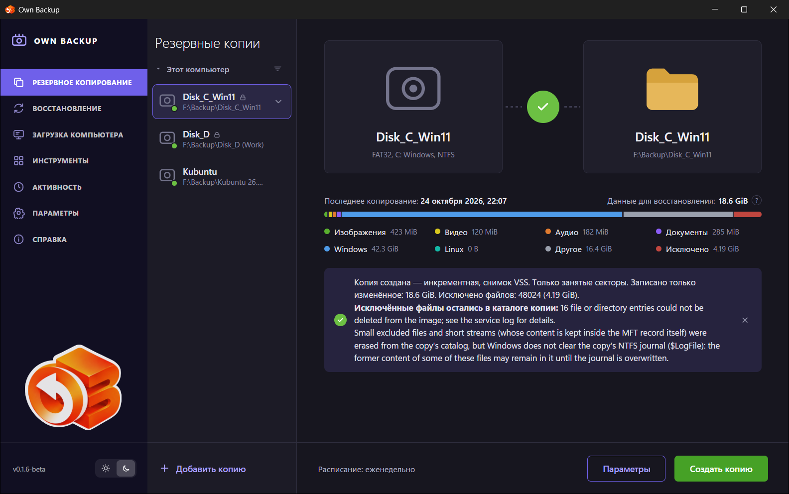

# Быстрый старт

На этой странице делается первая копия системного диска, она проверяется и
собирается загрузочный носитель — три дела, которые стоит сделать в день
установки программы.

## 1. Создайте задание

Откройте **Резервное копирование** и нажмите **Добавить копию**. Мастер
задания открывается на шаге **Источник** и сначала спрашивает, с каким диском
будет работать задание.

1. Щёлкните диск, на котором стоит система. Появятся его разделы; отметьте
   те, что нужно копировать. Для диска, который должен загружаться после
   восстановления, отметьте **Загрузочная копия диска** — она выбирает все
   разделы, нужные системе (EFI, системный, восстановления).
2. В блоке **Куда сохранять** выберите папку на другом диске — обычно на
   внешнем USB-диске. Имя файла программа подставит сама.
3. Проходите шаги кнопкой **Далее** или переходите на любой по его вкладке:
   - **Расписание** — например, *Еженедельно* в выбранные дни и время или
     *Не планировать*, чтобы запускать вручную;
   - **Схема** — формат (*OBK*, чтобы шифровать), уровень сжатия и способ
     копирования (*Инкрементное* — хорошее начало);
   - **Исключения** — список по умолчанию уже исключает файл подкачки, файл
     гибернации, корзину и временные папки;
   - **Дополнительно** — проверка после копии, повторы, действие после копии.
4. Нажмите **Сохранить**. Для OBK программа спросит пароль, а потом покажет
   **ключ восстановления** — сохраните его не на диске с копиями.

Подробности каждого шага — в [Резервном копировании](05-backup.md).

## 2. Запустите

Выберите задание и нажмите **Создать копию**. Страница показывает
этапы — поиск исключаемых файлов, копирование, удаление исключённых файлов из
образа, проверку — со скоростью и оставшимся временем.

Окно можно закрыть: служба продолжит, а значок в области уведомлений покажет,
что идёт копия. Когда она закончится, страница задания покажет итог.

## 3. Проверьте

Непроверенная копия — это надежда, а не копия.

- Если включено **Проверять резервную копию после создания** (по умолчанию включено),
  запуск уже перечитал каждый блок и сверил его контрольную сумму.
- Чтобы заглянуть внутрь, выберите в меню задания (кнопка **⌄** рядом с его
  именем) **Подключить как диск…**: разделы копии появятся как диски, только
  для чтения, и файлы можно открыть. Отключите копию в **Инструментах**, когда
  закончите.
- Настоящая проверка — восстановление на запасной диск или в виртуальную
  машину; см. [Восстановление](06-restore.md).

## 4. Соберите загрузочный носитель

Системный диск нельзя восстановить, пока система с него работает. Соберите
загрузочный носитель сейчас, пока компьютер исправен: **Инструменты →
Загрузочный носитель**, затем запишите ISO на флешку. См. [Загрузочный
носитель](10-bootable-media.md).
