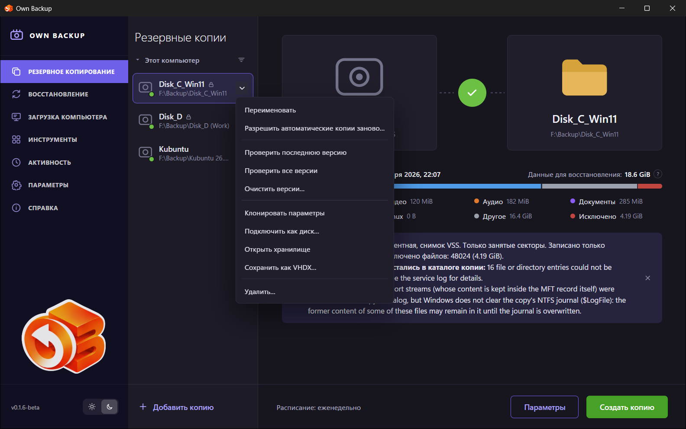
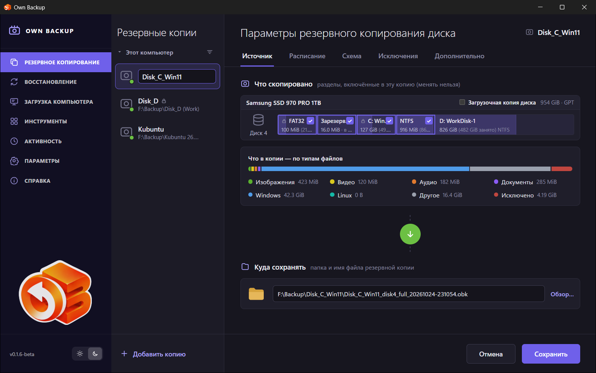
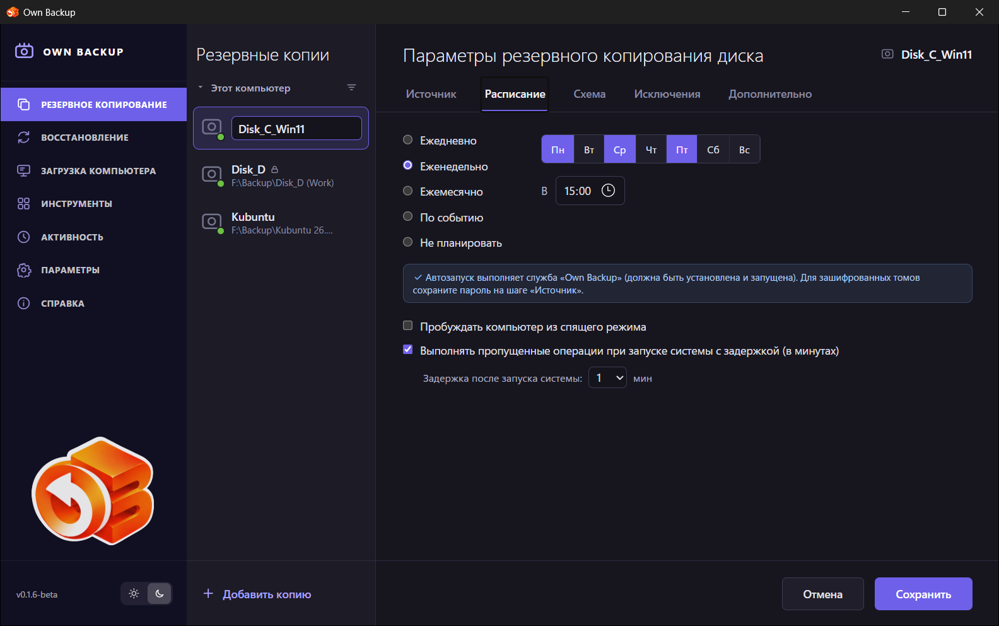
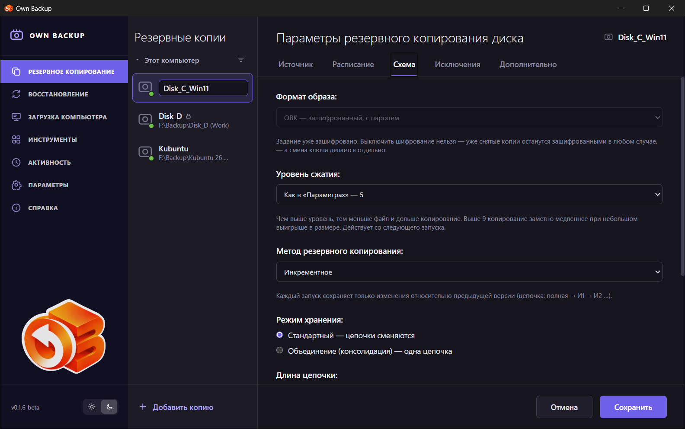
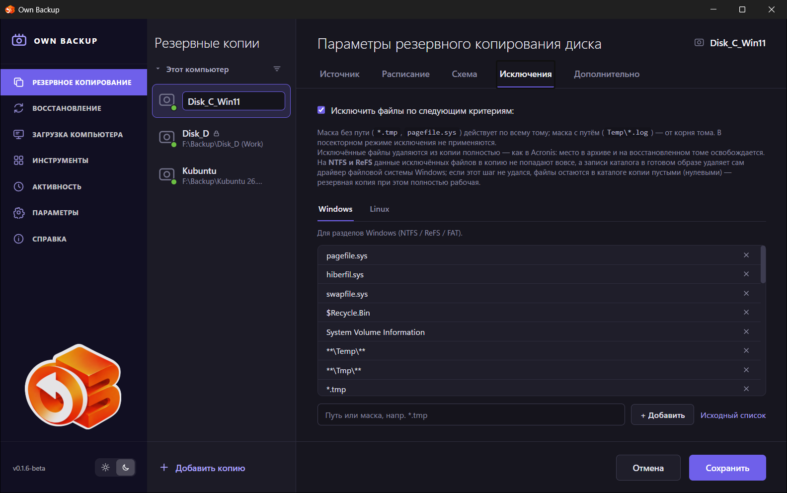
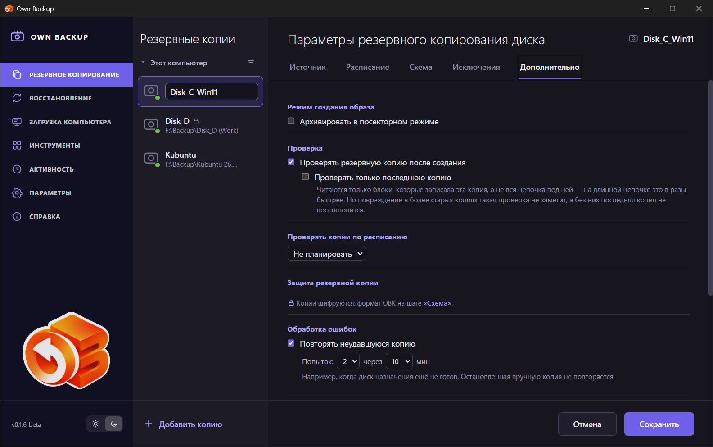

# Резервное копирование

На странице **Резервное копирование** задания создаются, запускаются и
наблюдаются.

## Список заданий

Средняя колонка — задания раздела **Этот компьютер**. У каждого видно имя,
папку назначения и цветную точку: зелёная — последний запуск успешен,
красная — с ошибкой, фиолетовая — выполняется сейчас. Замок отмечает
зашифрованное (OBK) задание. Кнопка **Сортировка** над списком меняет порядок.

**Добавить копию** внизу открывает мастер задания.

## Страница задания

Выбранное задание показывает:

- **Источник и назначение** — что копирует задание (его разделы) и папку, куда
  оно пишет. Круг между ними показывает ход запуска или итог последнего.
- **Последнее копирование** — когда сделана последняя версия.
- **Данные для восстановления** — сколько вернёт восстановление последней
  версии.
- **Что в копии — по типам файлов** — изображения, видео, аудио, документы,
  Windows, Linux, прочее и исключённое. Разбивка считается при просмотре
  файлов, до копирования.
- **Итог последнего запуска** — вид копии (полная, инкрементная,
  дифференциальная), как она читалась (снимок VSS, только занятые секторы),
  сколько записано, сколько файлов исключено, и заметки — например,
  исключённые файлы, оставшиеся в каталоге. **×** скрывает итог.
- **Расписание** — внизу, рядом с кнопками **Параметры** (мастер задания) и
  **Создать копию**.

### Запуск

**Создать копию** запускает задание сразу. Страница показывает этап:

| Этап | Что происходит |
|---|---|
| *Подготовка: поиск исключаемых файлов…* | Файловая система читается, чтобы найти исключаемые файлы и посчитать данные по типам. |
| *Резервное копирование…* | Копируются блоки; видны скорость, число блоков и оставшееся время. |
| *Завершение: освобождение снимка тома…* | Образ записан; снимок освобождается. |
| *Удаление исключённых файлов из образа…* | Имена исключённых файлов удаляются внутри готового образа (сначала он открывается — в Windows подключается как диск). |
| *Завершение: запись образа на диск…* | Образ сбрасывается на диск и публикуется под настоящим именем. |
| *Проверка этой резервной копии…* / *Проверка всех резервных копий…* | Если проверка включена: каждый блок перечитывается и сверяется. |

**Отмена** останавливает запуск; от него ничего не остаётся, прежние версии
не трогаются. Если несколько минут ничего не меняется, страница говорит об этом
и о том, что обычно бывает причиной.

## Меню задания

Кнопка **⌄** рядом с именем задания открывает его меню.

| Пункт | Что делает |
|---|---|
| **Переименовать** | Меняет имя в списке. Файлы на диске сохраняют свои имена, цепочка продолжается. |
| **Разрешить автоматические копии заново…** | Для зашифрованного задания, ключ которого служба больше не может открыть сама (переустановленная система, другой компьютер): один раз введите пароль или ключ восстановления, и копии по расписанию снова работают. |
| **Проверить последнюю версию** | Читает последнюю версию и её цепочку и сверяет каждый блок. |
| **Проверить все версии** | То же для всех версий в папке. |
| **Очистить версии…** | Список версий по цепочкам, с типом и размером. Отметьте, что удалить; версия, построенная на отмеченной, удаляется вместе с ней — без неё её не прочитать. Файлы удаляются навсегда. |
| **Клонировать параметры** | Открывает мастер с копией параметров этого задания для нового задания. |
| **Подключить как диск…** | Подключает выбранную версию как диск, по умолчанию только для чтения, чтобы скопировать из неё файлы. См. [Инструменты](08-tools.md#подключить-образ-как-диск). |
| **Открыть хранилище** | Открывает папку задания в файловом менеджере. |
| **Сохранить как VHDX…** | Сохраняет диск на момент выбранной версии одним файлом VHDX — без цепочки, сжатия и шифрования; его открывают Windows и любая виртуальная машина без Own Backup. Для зашифрованного задания сохранённый файл не зашифрован. |
| **Удалить…** | Удаляет задание после подтверждения. С галочкой **Удалить все связанные файлы** удаляются и файлы его копий; без неё они остаются. |

## Мастер задания

**Добавить копию** и **Параметры** открывают один и тот же мастер из пяти
шагов. Вкладки сверху переключают шаги; **Сохранить** (или **Создать копию**
для нового задания) сохраняет задание, **Отмена** — выход без изменений.

### Источник

- **Что копировать.** Сначала диск: мастер показывает все диски с разделами в
  масштабе. Щёлкните диск, затем отметьте разделы. **← другой диск**
  возвращает к списку. Задание работает с одним диском.
- **Загрузочная копия диска** отмечает то, с чего загружается система, —
  раздел EFI, раздел загрузчика, системный раздел, — чтобы восстановленный диск
  запускался. Разделы с данными выбираете вы. Раздел без файловой системы
  (например, зарезервированный Microsoft) попадает в копию только своей
  записью в таблице разделов.
- **Зашифрованные тома** (BitLocker, LUKS) спрашивают пароль или 48-значный
  ключ восстановления; **Расшифровать** проверяет его. **Общий пароль**
  открывает несколько томов одним паролем. **Запомнить** сохраняет его (под
  защитой системы), чтобы копии по расписанию могли открыть том, — без этого
  запуск по расписанию пропускается. Том, оставленный запертым, не копируется
  вовсе.
- **Что в копии — по типам файлов** показывает данные, которые попадут в
  копию.
- **Куда сохранять** — папка и имя файла. Назначение не может лежать на
  копируемом диске; мастер не даст его выбрать.

У существующего задания источник показан как **Что скопировано** — его нельзя
изменить, потому что уже сделанные версии должны оставаться одной цепочкой.

### Расписание

- **Ежедневно**, **Еженедельно** (дни недели), **Ежемесячно** (число 1–28),
  **В** заданное время; **По событию**; или **Не планировать** (запуск
  вручную).
- События: **При подключении диска, куда пишется копия** (копия начинается в
  течение 10 секунд после появления диска), **При входе пользователя**, **При
  выходе пользователя**, **При запуске системы (с задержкой)**. **Только один
  раз в день** не даёт событию запускать задание повторно в тот же день.
- **Пробуждать компьютер из спящего режима** — компьютер проснётся за минуту
  до запуска. В схеме электропитания должны быть разрешены таймеры
  пробуждения.
- **Выполнять пропущенные операции при запуске системы с задержкой** — запуск,
  пропущенный, пока компьютер был выключен, выполнится после следующего
  включения.

### Схема

- **Формат образа:** *VHDX — стандарт Windows (по умолчанию)*, *qcow2 —
  универсальный, со сжатием*, *OBK — зашифрованный, с паролем*. Для OBK дважды
  вводится **Пароль архива**. Формат задания, у которого уже есть копии,
  изменить нельзя, а шифрование нельзя выключить.
- **Уровень сжатия** (qcow2 и OBK): *Как в «Параметрах»* или 1–19.
- **Метод резервного копирования:** *Полное*, *Инкрементное*,
  *Дифференциальное* — см. [Основные понятия](03-concepts.md#версии-и-цепочки).
- **Режим хранения:**
  - *Стандартный — цепочки сменяются:* **Длина цепочки** — не больше N
    инкрементных версий в цепочке, затем новая полная копия начинает новую
    цепочку; **Правила очистки старых цепочек** — хранить не больше N последних
    цепочек, удалять цепочки старше N дней, не удалять первую (самую старую)
    цепочку. Цепочка удаляется целиком и только после успешной следующей
    копии.
  - *Объединение (консолидация) — одна цепочка:* **Делать объединение после**
    N инкрементных версий — самая старая версия вливается в полную копию.
    Полная копия при этом перестаёт быть копией дня своего создания.
    **Обновление цепочки** — *начинать цепочку заново, когда ей больше* N
    дней: сначала делается новая полная копия, потом удаляется старая цепочка.
  - Для *Полного*: **Правила очистки старых копий** — хранить N последних,
    удалять копии старше N дней, не удалять первую.

### Исключения

- **Исключить файлы по следующим критериям** включает правила.
- Два списка: **Windows** (NTFS, ReFS, FAT) и **Linux** (ext, XFS, btrfs;
  маски от корня тома, например `var/cache/**`).
- Введите путь или маску и нажмите **Добавить**; **×** удаляет маску;
  **Исходный список** возвращает список по умолчанию (файл подкачки, файл
  гибернации, файл свопа, корзина, System Volume Information, временные папки
  и файлы, кэши браузеров и системы).

Как работают исключения — в [Основных понятиях](03-concepts.md#исключения).

### Дополнительно

- **Режим создания образа — Архивировать в посекторном режиме:** каждый
  сектор, занятый или нет; исключения не действуют.
- **Проверка — Проверять резервную копию после создания** и **Проверять только
  последнюю копию** (читает только блоки, записанные этим запуском, — на
  длинной цепочке намного быстрее, но не заметит повреждения в старых
  версиях).
- **Проверять копии по расписанию:** регулярная проверка последней версии (или
  **всех версий**); итоги — в **Активности**. Она уступает всему, что вы
  запускаете над той же папкой.
- **Защита резервной копии** — зашифрованы ли копии (задаётся в *Схеме*).
- **Обработка ошибок — Повторять неудавшуюся копию:** *Попыток* и *каждые N
  мин* — для назначения, которое ещё не готово. Копия, остановленная вручную,
  не повторяется.
- **После копирования:** *Ничего не делать*, *Перевести компьютер в спящий
  режим* (через минуту после окончания), *Выключить компьютер* (с
  предупреждением за полторы минуты; отменяет `shutdown /a` в Windows или
  `shutdown -c` в Linux). Только если в очереди нет других копий.
- **Производительность — Низкий приоритет — не мешать работе** (диск и
  процессор сначала достаются другим программам) и **Ограничить скорость
  чтения** (МБ/с).

Пока идёт копия или восстановление, компьютер не уходит в спящий режим.
