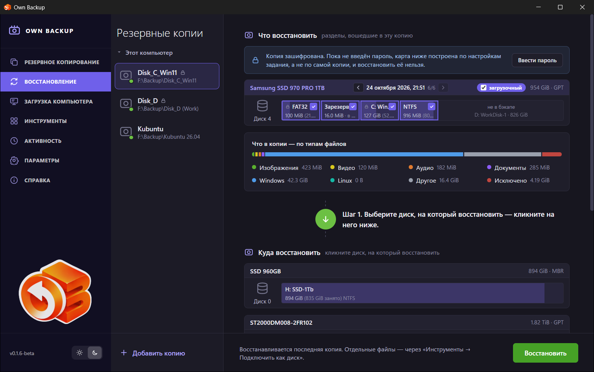

# Восстановление

Страница **Восстановление** записывает копию обратно на диск: целиком
(таблица разделов, загрузочные данные и все разделы) или по разделам. Чтобы
вернуть отдельные файлы, копию лучше подключить как диск — см.
[Инструменты](08-tools.md#подключить-образ-как-диск).

## Выбор копии

Средняя колонка — копии раздела **Этот компьютер**: одна строка на задание, с
числом версий. Чтобы восстановить копию, которой нет в списке (сделанную на
другом компьютере, скопированную откуда-то), нажмите **Добавить копию** и
выберите **Файл** (один образ) или **Папка с копиями** (все копии в ней). С
галочкой **Добавить файл(ы) бэкапа в список Резервных копий** копия останется в
списке и после перезапуска. Добавленную так копию можно потом убрать из
списка; её файлы при этом не удаляются.

## Что восстановить

Сверху показан диск, каким он был в копии, по разделам, и блок **Что в копии —
по типам файлов**. Стрелки у даты переключают версии (**Более старая копия**,
**Более новая копия**); по умолчанию выбрана последняя.

У **зашифрованной** копии, пока не введён пароль (**Ввести пароль**), карта
нарисована по параметрам задания. Восстановить её можно только после ввода
пароля — тогда же страница покажет, вернутся ли разделы зашифрованными.

## Куда восстановить

1. **Шаг 1. Выберите диск, на который восстановить** — щёлкните его в блоке
   **Куда восстановить**. Диск работающей системы не предлагается: его
   восстанавливают с [загрузочного носителя](10-bootable-media.md).
2. **Шаг 2.**
   - Для **загрузочной** копии (целого диска): щёлкните свободное (не
     распределённое) место — туда лягут все разделы копии вместе с
     загрузочными данными.
   - Для отдельных разделов: щёлкните раздел сверху (он станет жёлтым), затем
     раздел ниже — куда его скопировать.
3. **Шаг 3.** Повторите для остальных разделов и нажмите **Восстановить** или
   **Отмена**, чтобы начать заново. **Отменить последнее действие** — шаг
   назад.

Свободное место и разделы целевого диска можно сначала изменить: щёлкните
свободное место, чтобы **Создать раздел** (размер, файловая система, тип,
метка, буква диска, быстрое форматирование); правый щелчок по разделу —
**Расширить раздел**, **Удалить раздел** или **Присоединить раздел**. Пока план
не подтверждён, ничего не записывается.

Раздел восстанавливается блок за блоком, если целевой раздел не меньше; на
меньший раздел данные копируются пофайлово. На диск с другим размером сектора
(512 и 4096 байт) можно восстановить отдельные разделы, но не загрузочную
копию.

## Проверка плана и восстановление

**Восстановить** открывает **Проверку плана восстановления**: служба проверяет
план и показывает, что **Будут выполнены следующие операции**. Параметры:

- **Затирать свободное место** — обнулить и промежутки между занятыми блоками
  (копируются только занятые блоки, поэтому иначе старые данные физически
  остаются в промежутках). Дольше.
- **Проверять записанное после восстановления** — перечитать записанное.
- **Повторяющиеся идентификаторы** (Linux, когда исходные диски ещё в машине):
  *Оставить как есть*, *Сменить у восстановленной копии* или *Сменить и
  исправить fstab, crypttab и загрузчик восстановленной системы*. Две файловые
  системы с одним UUID путают систему, которая видит обе.
- **Вернуть шифрование разделу N** — для раздела LUKS, заголовок контейнера
  которого есть в копии: раздел вернётся зашифрованным, с тем же UUID и
  паролем. Без этого на разделе будет обычная файловая система.

Если в копии есть **записи загрузки** компьютера (загрузочная копия),
программа спросит **Восстановить записи загрузки?** — то, что прошивка
предлагает при включении, хранится в памяти материнской платы, а не на диске.
Текущие записи сначала сохраняются в файл.

Последний шаг — **Подтверждение восстановления**: введите **ДА** (заглавными),
чтобы продолжить. Отменить нельзя — всё на затронутых разделах будет
заменено.

Во время восстановления страница показывает ход, в конце — **Что осталось
сделать**, если что-то осталось (например, пересобранный initramfs в Linux или
повторное включение BitLocker).

## Зашифрованные разделы

- **LUKS:** копия хранит заголовок контейнера; с **Вернуть шифрование** раздел
  восстанавливается таким, каким был. Без этого Linux с такого раздела не
  загрузится (initramfs и `/etc/crypttab` ждут контейнер).
- **BitLocker:** раздел возвращается **расшифрованным** — Windows с него
  загрузится, но если диск должен быть зашифрован, включите BitLocker в
  Windows заново.

## Восстановление системного диска

1. Загрузите компьютер с [загрузочного носителя](10-bootable-media.md).
2. Откройте **Восстановление**, добавьте копию (**Добавить копию → Папка с
   копиями**), если её нет в списке, выберите версию и целевой диск.
3. Восстановите, ответьте на **Восстановить записи загрузки?**, выньте
   носитель и перезагрузитесь.
