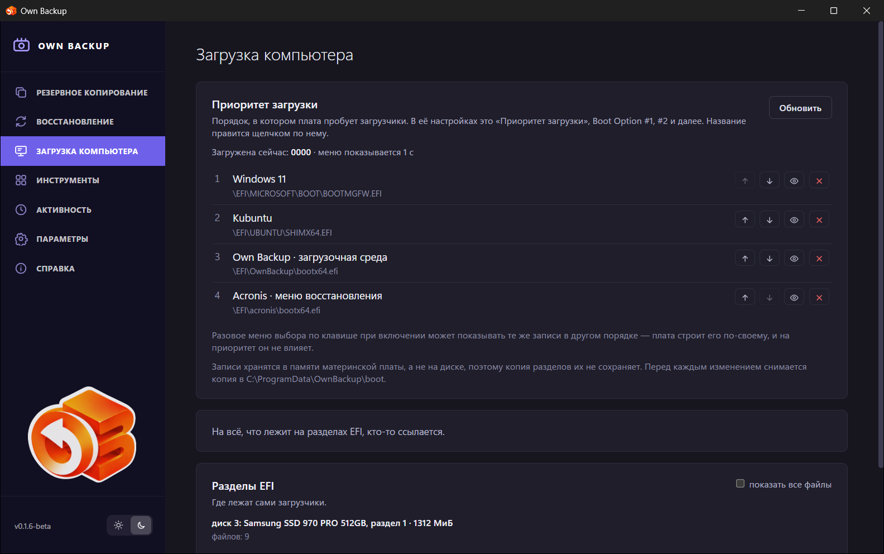

# Загрузка компьютера

Страница **Загрузка компьютера** показывает и правит **записи загрузки UEFI**
— список, по которому прошивка идёт при включении. Эти записи хранятся в
памяти материнской платы, а не на диске, поэтому копия разделов их не содержит
(загрузочная копия целого диска записывает их отдельно, см.
[Восстановление](06-restore.md)).

## Приоритет загрузки

Порядок, в котором плата пробует загрузчики, — в её настройках это
«Приоритет загрузки», *Boot Option #1, #2…*. Над списком:

- **Загружена сейчас** — запись, с которой система запущена сейчас;
- **меню показывается N с** — время показа меню загрузки прошивки;
- **один раз загрузится с …** — если запись назначена только на следующий
  запуск.

У каждой записи видно имя и файл загрузчика. Кнопки справа:

| Кнопка | Что делает |
|---|---|
| ↑ / ↓ (**Выше**, **Ниже**) | Меняет порядок. |
| 👁 (**Убрать из меню** / **Показывать в меню**) | Оставляет запись, но убирает её из порядка — плата её не предлагает. |
| × (**Удалить запись**) | Удаляет запись. Файл загрузчика остаётся на разделе. |

Щёлкните имя, чтобы **Переименовать** запись. Записи, разобранные не
полностью или указывающие на устройство, а не на файл, править нельзя.

**Перед каждым изменением текущие записи сохраняются в файл** в папке
программы `boot`, так что изменение можно отменить вручную.

Разовое меню выбора, которое открывается клавишей при включении, может
показывать те же записи в другом порядке: плата строит его по-своему, и на
приоритет оно не влияет.

## Загрузчики без записи

Файлы на разделах EFI, на которые не указывает ни одна запись. **Добавить в
меню** создаёт для такого файла запись (с именем, которое вы зададите). Если у
всех загрузчиков есть записи, страница пишет *На всё, что лежит на разделах
EFI, кто-то ссылается*.

## Разделы EFI

Где лежат сами загрузчики: каждый раздел EFI каждого диска, с размером и
загрузчиками. **показать все файлы** показывает все файлы, а не только
загрузчики. У каждого загрузчика отмечено состояние: *запись N*, *запасной
путь съёмного носителя*, *запускает другой загрузчик*, *записи нет*.

## Заметки

- У компьютера, который загружается не через UEFI (старый BIOS), таких
  записей нет; страница говорит об этом.
- Имена записей хранятся в прошивке такими, какими были записаны. Запись,
  созданная программой, когда её язык был русским, остаётся с русским именем,
  пока вы её не переименуете.
- В Linux для изменений нужно разрешение polkit `boot-config`; то же можно
  сделать командой `efibootmgr`.
