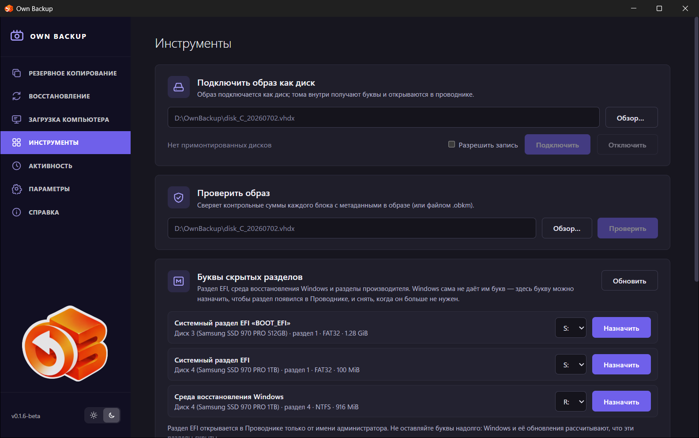
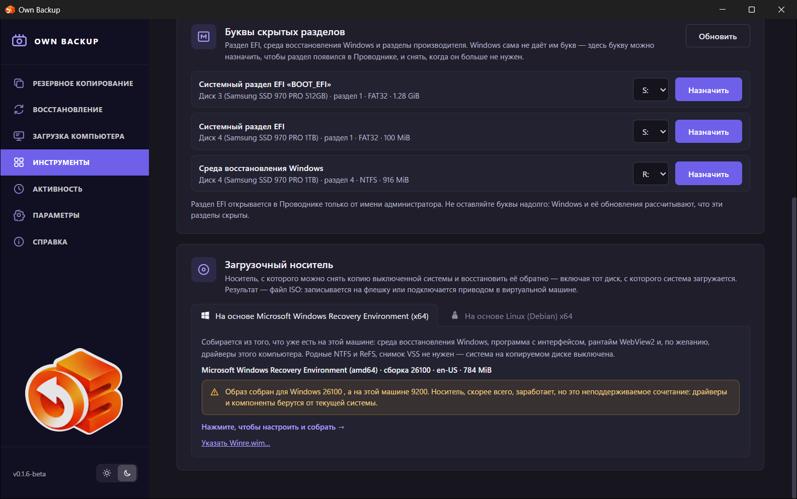

# Инструменты

## Подключить образ как диск

Подключает образ копии как диск, чтобы открыть его содержимое и скопировать
файлы, — так восстанавливаются отдельные файлы.

1. Введите путь к образу или нажмите **Обзор…** (`.vhdx`, `.avhdx`, `.qcow2`,
   `.obk`). Инкрементная версия подключается вместе со своей цепочкой.
2. Не включайте **Разрешить запись** без нужды: подключение только для чтения
   не может изменить копию.
3. Нажмите **Подключить**. Зашифрованная (OBK) копия сначала спросит пароль
   или ключ восстановления.

В **Windows** образ подключается через собственный iSCSI-инициатор Windows
(сторонний драйвер не ставится); его тома получают буквы и открываются в
проводнике. В **Linux** образ отдаётся через устройство ядра NBD, только для
чтения, и его том монтируется в папку.

Список ниже показывает подключённое; **Отключить** отключает выбранный образ.

То же доступно из задания: **⌄ → Подключить как диск…** позволяет выбрать
версию.

## Проверить образ

Сверяет каждый блок образа с контрольными суммами, хранящимися в нём.
Выберите образ и нажмите **Проверить**; инкрементная версия проверяется вместе
с цепочкой. Итог — *Целостность подтверждена: N блоков за S с* или *Копия
повреждена: не совпали контрольные суммы у N из M блоков*. Полоса хода и итог
сохраняются, если уйти со страницы и вернуться.

## Буквы скрытых разделов

Windows не даёт букву системному разделу EFI, среде восстановления Windows и
разделам производителя. Здесь можно **Назначить** букву, чтобы раздел
появился в проводнике, и **Снять букву**, когда она больше не нужна. Раздел EFI
открывается в проводнике только от имени администратора. Не оставляйте буквы
надолго: Windows и её обновления рассчитывают, что эти разделы скрыты. (Только
Windows.)

## Загрузочный носитель

Собирает загрузочный носитель — систему, которая запускается с флешки или
диска вместе с программой, чтобы восстановить системный диск или сделать копию
компьютера, который не запускается. Два вида:

- **На основе Microsoft Windows Recovery Environment (x64)** — собирается в
  Windows из того, что уже есть на машине: среды восстановления Windows,
  программы, среды WebView2 и, по желанию, драйверов этого компьютера.
- **На основе Linux (Debian) x64** — небольшая система Debian с программой;
  читает ext4, btrfs, XFS и LUKS напрямую и восстанавливает и копии Windows.
  В Linux собирается из установленного пакета или скачивается готовым из
  выпуска; в Windows скачивается готовый ISO этой версии из выпуска.

Подробности, запись на флешку и работа с носителя — в [Загрузочном
носителе](10-bootable-media.md).

## Разделы Linux в Total Commander (Windows)

Плагин для Total Commander показывает файлы разделов Linux этого компьютера:
ext2/3/4 и btrfs, в том числе внутри LVM и зашифрованного LUKS (так ставится
Ubuntu с шифрованием диска). Раздел читается на месте, **только для чтения**: ничего не
подключается и не отключается, остальные разделы того же диска (например,
диск с данными Windows) продолжают работать. Читает служба Own Backup, поэтому
она должна быть установлена и запущена.

**Подключить плагин** (один раз): в Total Commander 64-bit откройте архив
`C:\Program Files\OwnBackup\TotalCommander\OwnBackup-TC-plugin.zip`
(Enter на файле). Total Commander сам предложит установить плагин и
скопирует его в свою папку плагинов. После обновления Own Backup установите
его из архива так же заново — копия в папке Total Commander сама не
обновляется.

**Пользоваться:** откройте **Сеть / Сетевое окружение** (`\\\`) → **Own Backup
Linux**. Там список разделов вида «Диск 3 · раздел 3 · 128 ГБ · LUKS». Для
зашифрованного раздела Total Commander спросит пароль шифрования; если внутри
LVM, появятся его тома (`vgubuntu-root`), раздел подкачки не показывается.
btrfs показывается так, как система видит его после загрузки: по её
`/etc/fstab` подтом `@` — это корень, `@home` — папка `\home` и так далее.
Если fstab не нашёлся, подтома видны отдельными папками (`@`, `@home`).
Сжатые файлы (zstd, zlib, LZO) читаются как есть.
Файлы копируются (F5), просматриваются (F3) и открываются (Enter) как обычно;
изменить, удалить или переместить что-либо на разделе нельзя.

- Символы, которые Windows не допускает в именах (`: ? * " < > |`), а также
  имена не в UTF-8 показываются заменёнными символами — как у WSL; файлы
  копируются под этими именами.
- Символьные ссылки показываются тем, на что указывают; специальные файлы
  (устройства, сокеты) не показываются.
- Если Linux был выключен некорректно, ext4 читается с учётом журнала (в
  памяти, на диск ничего не пишется); у btrfs видно последнее записанное
  состояние — без нескольких последних секунд до сбоя.
- btrfs на нескольких дисках или в RAID не читается.
- Пароль хранится в памяти Total Commander до его закрытия: после получаса
  простоя раздел открывается заново без повторного вопроса.
