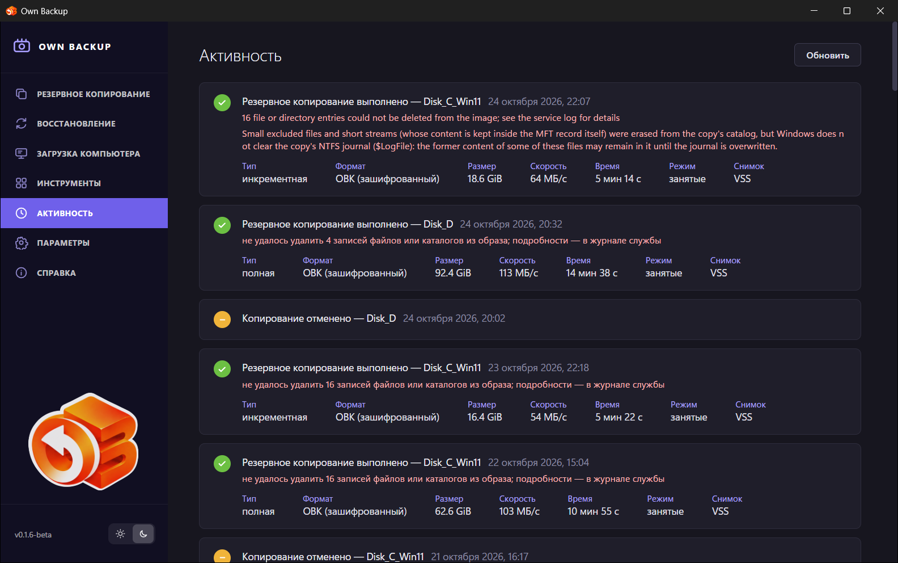
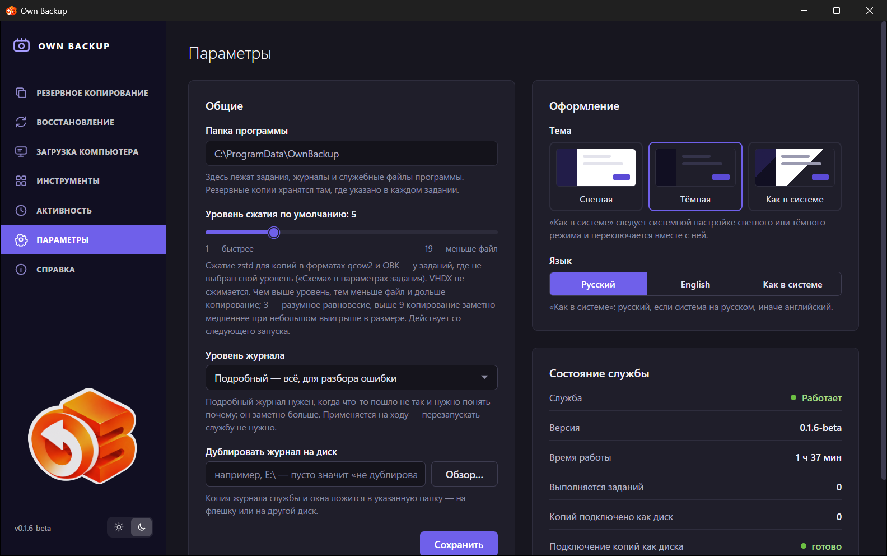
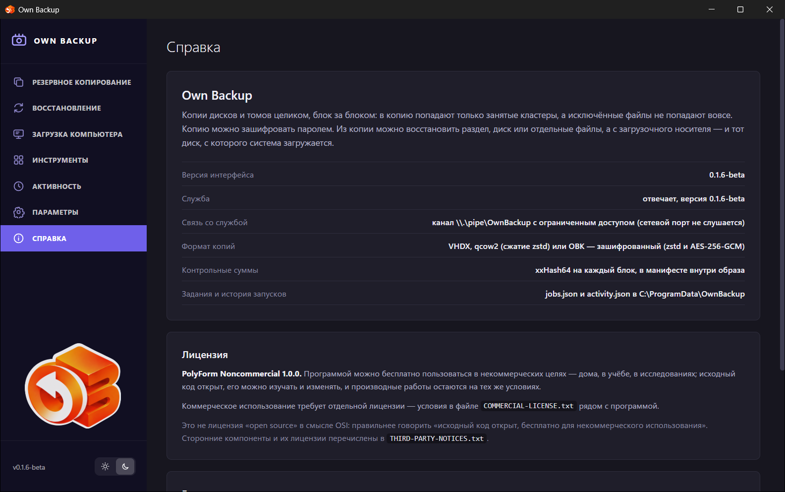

# Активность, Параметры, Справка

## Активность

История копий, восстановлений и проверок по расписанию, новые сверху.
**Обновить** перечитывает её. У каждой записи — итог и время:

- *Резервное копирование выполнено*, *Сбой резервного копирования*,
  *Копирование отменено*, *Копирование прервано* (служба остановилась во время
  запуска — расписание его повторит), *Копия по расписанию не запущена*
  (например, не сохранён пароль);
- *Восстановление выполнено*, *Сбой восстановления*, *Восстановление
  отменено*;
- *Копии проверены*, *Проверка копий не пройдена*, *Проверка копий отменена*.

Под ними — заметки и ошибки красным и подробности: **Тип** (полная,
инкрементная, дифференциальная), **Формат**, **Размер**, **Скорость**,
**Время**, **Режим** (*занятые* или *посекторно*), **Снимок** (*VSS*, снимок
LVM или device-mapper, или *не нужен (офлайн)* на загрузочном носителе). У
восстановления — целевой диск, **Операций** выполнено из запланированных и
**Что осталось сделать**, если что-то осталось.

У выполненной копии здесь же записаны сведения из карточки **Копия создана** со
страницы задания. Эту карточку можно закрыть крестиком, вернуть её нельзя; у
следующей копии будет своя.

История хранит последние 200 запусков. Её заметки остаются на том языке, на
котором программа работала в момент запуска.

## Параметры

### Общие

- **Папка программы** — где лежат задания, журналы и служебные файлы
  (показывается, здесь не меняется).
- **Уровень сжатия по умолчанию** — от 1 (быстрее) до 19 (меньше файл), для
  заданий qcow2 и OBK без своего уровня. Действует со следующего запуска.
- **Уровень журнала** — *Основной — ход работы и ошибки* или *Подробный — всё,
  для разбора ошибки*. Применяется сразу.
- **Дублировать журнал на диск** — копия журналов службы и окна ложится в эту
  папку (флешка, другой диск): она уцелеет, даже если восстановление сотрёт
  диск, на котором лежали журналы.

**Сохранить** применяет общие параметры. Их записывает служба, поэтому запрос
прав администратора не нужен.

### Оформление

- **Тема** — *Светлая*, *Тёмная*, *Как в системе*. Её переключают и кнопки
  солнца и луны внизу меню.
- **Язык** — *Русский*, *English*, *Как в системе* (русский, если система на
  русском, иначе английский). Применяется сразу, без перезапуска.

### Состояние службы

Работает ли служба, её **Версия**, **Время работы**, **Выполняется заданий**,
**Копий подключено как диск** и готово ли **Подключение копий как диска**
(iSCSI в Windows; NBD и ntfs-3g в Linux).

### Значок в области уведомлений

Показывать ли значок. Он появляется при входе в систему и виден, пока служба
работает; подсказка у него — *Own Backup — служба работает*. Щелчок открывает
окно; в его меню — **Открыть Own Backup** и **Скрыть значок**.

## Справка

- Описание программы, **Версия интерфейса** и версия **Службы**, **Связь со
  службой** (именованный канал или Unix-сокет, без сетевого порта), **Формат
  копий**, **Контрольные суммы** и где лежат **Задания и история запусков**.
- **Лицензия** — PolyForm Noncommercial 1.0.0, что она разрешает и где условия
  коммерческой лицензии и сторонних компонентов.
- **Если что-то не получилось** — где история и журналы, копия журнала и
  загрузочный носитель для системы, которая не запускается.
