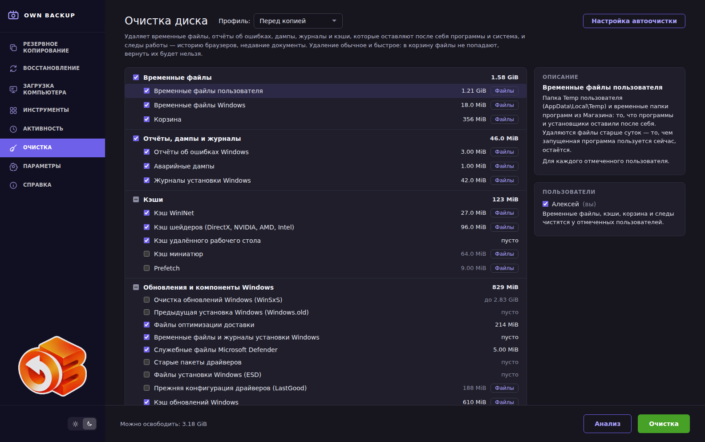

# Очистка диска (Windows и Linux)

Раздел **Очистка** удаляет то, что программы и Windows оставляют после себя:
временные файлы, отчёты об ошибках, аварийные дампы, журналы установки,
кэши, корзину и следы работы — историю браузеров, недавние документы.
Работает служба Own Backup, поэтому ей доступны и системные
папки, и папки пользователей. В Linux свои пункты — см. «Linux» ниже; на
загрузочном носителе раздела нет.

## Как пользоваться

1. Отметьте пункты. Слева — группы и пункты, справа — описание выбранного
   пункта и список пользователей, чьи папки чистятся.
2. Нажмите **Анализ**: объём появится у каждого пункта, в том числе
   неотмеченного, внизу — сколько освободят отмеченные. Ничего не удаляется.
   Кнопка **Файлы** у пункта открывает список того, что будет удалено: путь,
   размер, дата, поиск, крупные сначала или по пути; у следов Windows — и
   записи реестра. Снимите галочку у файла, который нужен, — он останется. Очистка удалит ровно этот
   список у отмеченных пунктов: файлы, появившиеся после анализа, останутся.
   Отметки можно менять и после анализа; если изменить пользователей или срок
   хранения истории, анализ сбрасывается — нажмите **Анализ** снова.
   У пункта **История браузеров** в описании выбирается, сколько истории
   хранить: удалить всю, оставить последний день, неделю или месяц.
3. Нажмите **Очистка** и подтвердите **Удалить**. Ход виден у пунктов, внизу —
   итог: сколько освобождено и сколько файлов осталось, потому что их держат
   открытыми программы. Итог записывается в **Активность**.

Выбор пунктов и пользователей запоминается.

Отметки соблюдаются всегда. Если анализ успел устареть (служба перезапустилась,
прошла другая очистка) и у пунктов сняты галочки, **Очистка** ничего не удаляет
и просит нажать **Анализ** снова.

## Профили очистки

Отмеченное на странице можно сохранить под своим названием: внизу списка,
строка **Профиль очистки**, кнопка **Сохранить профиль как…**. Сохраняются
пункты, пользователи и сроки (история браузеров, маски). То же название
заменяет прежний профиль. Сохранённые профили:

- выбираются в задании копии, на вкладке **Очистка**: перед копией диск чистится
  по выбранному (см. [Резервное копирование](05-backup.md#очистка));
- открываются списком **Профиль:** вверху страницы — отметки на странице
  становятся такими, как в профиле; **свой выбор** — ваши отметки.

Профиль хранит служба, с правами того, кто его сохранил; изменить или удалить
чужой профиль может только администратор компьютера. Профиль, по которому
чистит какое-то задание, удалить нельзя.

## Автоочистка и очистка перед копией

Вверху страницы — кнопка **Настройка автоочистки**. Служба чистит сама,
без окна: по расписанию (ежедневно, еженедельно по дням, ежемесячно; можно
выполнить пропущенную очистку после включения компьютера) и перед копией в
заданиях, где на вкладке «Очистка» параметров копии отмечено **«Очистить диск перед
копией»** — по выбранному там профилю или по набору автоочистки. Чистится то,
что отмечено на странице в момент нажатия «Сохранить», у отмеченных
пользователей, с теми же сроками (история браузеров, маски не входят). **Файлы по маскам в автоочистку не входят** —
они удаляются только после просмотра списка. Набор сохраняется с правами
того, кто его сохранил, и проверяется заново при каждом запуске. Итог
записывается в «Активность» как «Автоочистка по расписанию» или «Очистка
перед копией «…»». Если очистка перед копией не может пройти (например,
идёт другая), копия всё равно делается. Запуском задания она не считается, а
**Отмена** у задания останавливает и её.

## Что удаляется

| Пункт | Где | Что остаётся |
|---|---|---|
| Временные файлы пользователя | `AppData\Local\Temp`, `AppData\Local\Packages\*\AC\Temp` | файлы моложе суток |
| Временные файлы Windows | `Windows\Temp`, временные папки системных служб | файлы моложе суток |
| Корзина | `$Recycle.Bin` пользователя на каждом диске | — |
| Отчёты об ошибках Windows | `ProgramData\Microsoft\Windows\WER`, `AppData\Local\Microsoft\Windows\WER` | — |
| Аварийные дампы | `Windows\MEMORY.DMP`, `Windows\Minidump`, `Windows\LiveKernelReports`, `AppData\Local\CrashDumps` | — |
| Журналы установки Windows | `Windows\Logs\CBS`, `DISM`, `WindowsUpdate`, `waasmedic`, `SIH`, `NetSetup`, `MoSetup`; `Windows\Panther`, `Windows\debug`; `ProgramData\USOShared\Logs` | журналы моложе недели |
| Кэш WinINet | `AppData\Local\Microsoft\Windows\INetCache` | — |
| Кэш шейдеров | `D3DSCache`, кэши NVIDIA, AMD и Intel, в том числе в `AppData\LocalLow` | — |
| Кэш удалённого рабочего стола | `AppData\Local\Microsoft\Terminal Server Client\Cache` | открытый клиент удалённого рабочего стола |
| Кэш миниатюр (по умолчанию выкл.) | `AppData\Local\Microsoft\Windows\Explorer` | файлы, которые держит Проводник |
| Prefetch (по умолчанию выкл.) | `Windows\Prefetch` | — |
| Прежняя конфигурация драйверов (по умолчанию выкл.) | `Windows\LastGood`, `Windows\LastGood.Tmp` | файлы моложе недели |
| Кэш обновлений Windows | `Windows\SoftwareDistribution\Download` | файлы моложе суток; журнал обновлений `DataStore`; неустановленное Windows скачает снова |
| Кэш браузеров | кэш Chrome, Edge, Vivaldi, Brave, Яндекс, Opera, Firefox, Thunderbird во всех профилях | открытый браузер |
| История браузеров (по умолчанию выкл.) | `History` браузеров на Chromium — целиком или старше выбранного срока (база правится на копии и проверяется); `Visited Links`, `Top Sites`, `Shortcuts`, `Favicons`. При частичной очистке вместе со старыми посещениями удаляются их поисковые запросы, заметки и группы истории | закладки, пароли; история Firefox (она в одной базе с закладками); база с журналом аварийной записи |
| Cookie браузеров (по умолчанию выкл.) | `Cookies` браузеров на Chromium, `cookies.sqlite` Firefox и Thunderbird | открытый браузер |
| Сессии браузеров — открытые вкладки (по умолчанию выкл.) | `Sessions` браузеров на Chromium, `sessionstore` Firefox | cookie (отдельный пункт); открытый браузер. Firefox хранит в сессии cookie «до закрытия браузера» — на сайтах, где вход держится только на них, придётся войти заново |
| Отчёты о сбоях браузеров | `Crashpad\reports` браузеров на Chromium; `Crash Reports\pending`, `submitted` и `minidumps` Firefox и Thunderbird | открытый браузер |
| Недавние документы (по умолчанию выкл.) | ярлыки `AppData\Roaming\Microsoft\Windows\Recent\*.lnk`; в реестре `Explorer\RecentDocs`, `ComDlg32\OpenSavePidlMRU`, `OpenSaveMRU`, `LastVisitedPidlMRU` | сами документы |
| Списки переходов (по умолчанию выкл.) | `Recent\AutomaticDestinations`, `Recent\CustomDestinations` | папки, закреплённые на панели быстрого доступа Проводника |
| История «Выполнить» и Проводника (по умолчанию выкл.) | в реестре `Explorer\RunMRU`, `TypedPaths`, `WordWheelQuery` | — |
| Подключения к удалённому рабочему столу (по умолчанию выкл.) | в реестре `Terminal Server Client\Default` (`MRU*`), `Servers`; `Документы\Default.rdp` | сохранённые пароли (диспетчер учётных данных), другие файлы `.rdp` |
| Недавние документы Microsoft Office (по умолчанию выкл.) | в реестре `Office\<версия>\<программа>\File MRU`, `Place MRU`, в том числе `User MRU\<учётная запись>` — только `Item N`; ярлыки `AppData\Roaming\Microsoft\Office\Recent` | места, закреплённые в списках; открытая программа Office |
| Недавние файлы программ (по умолчанию выкл.) | в реестре: Paint, WordPad, Проигрыватель Windows Media, MPC-HC (`Recent File List`, `MediaHistory`, `PlaylistHistory`), 7-Zip (`FolderHistory`, `CopyHistory`, `PanelPath*`, `ArcHistory`, `PathHistory`), WinRAR, Adobe Acrobat Reader, `LastKey` редактора реестра | настройки программ (избранные папки 7-Zip, настройки MPC-HC); открытая программа |
| Кэши программ | миниатюры XnView MP (`Thumb.db`), кэш Discord, Visual Studio Code, VSCodium, TradingView, Slack, Obsidian, Signal, Element, Termius, `Steam\htmlcache` | вход, настройки и данные программ; открытая программа |
| Кэш Telegram Desktop (по умолчанию выкл.) | `tdata\user_data*\cache`, `media_cache`, `wvbots` всех учётных записей | вход и переписка; открытый Telegram. В мини-приложения может понадобиться войти заново |
| Кэши разработчика (по умолчанию выкл.) | `npm-cache\_cacache`, `pip\cache`, `uv\cache`, `Yarn\Cache`, `NuGet\v3-cache`, `go-build`, `.cargo\registry\cache`, `.gradle\caches` | Python и инструменты uv (`Roaming\uv`) |
| Скачанные обновления программ (по умолчанию выкл.) | `AppData\Local\*-updater` | файлы моложе суток; нужное обновление программа скачает снова |
| Журналы программ | папки журналов qBittorrent, Zed, DaVinci Resolve, OBS Studio, npm | журналы моложе недели; проекты и база проектов DaVinci Resolve; открытая программа |
| Установщики драйверов (по умолчанию выкл.) | `C:\NVIDIA\DisplayDriver`, `C:\AMD`, `ProgramData\NVIDIA Corporation\Downloader\*` | моложе суток; установленный драйвер |

### Обновления и компоненты Windows

То, что Windows хранит для себя, удаляется не по файлам, а её собственными
средствами — DISM и обработчиками, которые вызывает «Очистка диска» (cleanmgr):
они сами считают объём и сами удаляют. Удалять эти пункты может только
администратор компьютера (окно запускать «от имени администратора» не
нужно — работу делает служба); объём виден любому пользователю.

| Пункт | Средство Windows | Что после очистки |
|---|---|---|
| Очистка обновлений Windows (WinSxS) (по умолчанию выкл.) | DISM (`/AnalyzeComponentStore`, `/StartComponentCleanup`) | заменённые обновления нельзя удалить; подсчёт — около минуты, очистка — до нескольких минут |
| Предыдущая установка Windows (Windows.old) (по умолчанию выкл.) | Previous Installations | вернуться к прежней версии Windows нельзя |
| Файлы оптимизации доставки | Delivery Optimization Files | — |
| Временные файлы и журналы установки Windows | Temporary Setup Files, Windows Upgrade Log Files, Windows Reset Log Files, Upgrade Discarded Files | — |
| Служебные файлы Microsoft Defender | Windows Defender | — |
| Старые пакеты драйверов (по умолчанию выкл.) | Device Driver Packages | к прежнему драйверу не откатиться |
| Файлы установки Windows (ESD) (по умолчанию выкл.) | Windows ESD installation files | «Вернуть компьютер в исходное состояние» — только с загрузкой из облака или с носителя |

DISM не сообщает, сколько освободит очистка хранилища компонентов. При анализе
у пункта написано **до …**: это резервные копии и отключённые компоненты, которые
хранит WinSxS, то есть верхний предел. Сколько освободилось на самом деле, видно
после очистки.

### Файлы по маскам

Пункт **Файлы по маскам** (по умолчанию выкл.) ищет брошенные файлы по маскам
имён — как «очистка мусора» в Ace Utilities, но осторожнее:

- **Где.** В профилях отмеченных пользователей; администратор компьютера
  может добавить другие папки и диски («Где ещё искать»).
- **Куда не заходит никогда:** `Windows`, `Program Files`, `ProgramData`,
  `AppData` и скрытые папки (`.cargo`, `.npm`, `.config`, `.git`… — данные программ, мусор программ — дело других пунктов), `node_modules`,
  облачные папки (OneDrive, Dropbox, Google Drive, Яндекс Диск — удаление
  там удалило бы файл и в облаке), ссылки и точки соединения. Файлы этой
  программы (`.own-backup-*`) и образы копий (`.obk`, `.vhdx`, `.qcow2`) не
  трогаются при любых масках.
- **Маски** — список как в Ace Utilities (кнопка «Маски…» в описании
  пункта): маска, вид и что она находит. Включены временные файлы и мусор
  (`*.tmp`, `*.temp`, `~$*`, `*.~*`, `*.$$$`, `Thumbs.db`, `*.dmp`, `*.gid`
  …); выключены резервные копии (`*.bak`, `*.old`, `*.prv`, `*.wbk` — в них
  бывают ваши документы и ключи программ), журналы (`*.log`, `*log.txt`),
  куски файлов после проверки диска (`*.chk`), промежуточные файлы
  сборки. Маски `*.tmp*` из списка Ace нет: она захватывает шаблоны
  `.tmpl`. Можно добавить свои маски.
  Маска — только имя файла, и она не должна захватывать обычные файлы:
  `*.*`, `*.d*` (поймала бы `.docx`), `K*` не принимаются.
- **Срок.** Удаляются файлы старше суток, недели (по умолчанию), месяца или
  трёх месяцев.
- **Только после просмотра.** Очистить этот пункт можно, только когда после
  анализа открыт его список **Файлы**; служба без анализа его не удаляет.
  В списке у каждого файла есть галочка — снимите её, и файл останется.
  Папки не удаляются.

## Linux

В Linux служба работает от root, и пункты свои:

| Пункт | Где | Что остаётся |
|---|---|---|
| Кэш пакетов apt (только администратор) | `/var/cache/apt/archives/*.deb`, `partial`, `*.bin` | установленные программы, `lock` |
| Старые журналы /var/log (администратор) | копии logrotate: `*.gz`, `*.1`…`*.9`, `*-20…` | текущие журналы, копии моложе суток |
| Журнал systemd (администратор) | `journalctl --vacuum-size=200M` | последние 200 МБ |
| Отчёты о сбоях (администратор) | `/var/crash`, `/var/lib/systemd/coredump` | — |
| Старые версии snap (администратор) | `snap remove --revision` отключённых версий | текущие версии |
| Кэш snapd (администратор) | `/var/lib/snapd/cache` | сами snap-пакеты |
| Неиспользуемые среды flatpak (администратор) | `flatpak uninstall --unused` в системной установке | программы и нужные им среды, закреплённые среды |
| Ненужные пакеты (администратор, выкл.) | `apt-get autoremove --purge` (и старые ядра) | — |
| Списки пакетов apt (администратор, выкл.) | `/var/lib/apt/lists` | `lock`, `partial` |
| Корзина | `~/.local/share/Trash` | — |
| Кэш миниатюр, шейдеров, шрифтов | `~/.cache/thumbnails`, `mesa_shader_cache`, `nvidia/GLCache`, `fontconfig` | — |
| Браузеры | Chrome, Chromium, Edge, Vivaldi, Brave, Яндекс, Opera (`~/.config`, `~/.cache`), Firefox и Thunderbird, в том числе snap и flatpak | как в Windows: пароли, закладки, автозаполнение — никогда |
| Кэши npm, pip, Go, Cargo, Yarn, Playwright, Gradle (выкл.) | `~/.npm/_cacache`, `~/.cache/pip`, `go-build`, `~/.cargo/registry/cache`… | — |
| Мусор редакторов и инструментов | архивы расширений Cursor, журналы, временная сборка и кэш npm Zed, JNA, демон Gradle, gopls, staticcheck | сессии и память ИИ-агентов (`~/.claude`, `~/.codex`, `~/.gemini`, `~/.copilot`, opencode) — никогда |
| Кэши программ | `Cache`, `Code Cache`, `GPUCache` в `~/.config` у VS Code, VSCodium, Discord, Slack, Obsidian, Signal, Element, TradingView, Termius; браузер Steam | вход, настройки и данные программ; открытая программа |
| Кэш Telegram Desktop (выкл.) | `tdata/user_data*/cache`, `media_cache` — своя сборка, snap и flatpak | вход и переписка |
| Недавние файлы (выкл.) | `recently-used.xbel`, `~/.local/share/RecentDocuments` | сами файлы |
| Файлы по маскам | домашние папки (плюс маски `*Zone.Identifier`, `.DS_Store`, `*.swp`, `*.orig`, `*.rej`) | скрытые папки, другие файловые системы |

- **Папки пользователя служба чистит с правами самого пользователя**
  (`setfsuid`/`setfsgid` на время прохода): подменённая ссылка или папка не
  заставит root удалить то, что пользователь сам удалить не может, а
  урезанная история браузера остаётся файлом пользователя.
- Системные пункты — только администратору: root или участнику групп
  `sudo`, `wheel`, `admin`.
- Сокеты, каналы и устройства не удаляются никогда; `/tmp` и `/var/tmp` не
  трогаются — их чистит systemd-tmpfiles.
- Вывод команд (`snap`, `apt-get`, `flatpak`) читается в языке C, а не в языке системы.

## Что гарантировано

- **Удаление обычное и быстрое.** Файлы не попадают в корзину и не
  перезаписываются; вернуть их нельзя.
- **Только перечисленные папки.** Очистка не ищет файлы по маскам по всему
  диску: маска вроде `*.prv` или `*.bak` задевает ключи программ и запасные
  копии документов.
- **Свежее не трогается.** Во временных папках удаляются только файлы, не
  менявшиеся больше суток (берётся более позднее из времени изменения и
  создания), — то, чем сейчас пользуется программа или установщик, остаётся.
- **Ссылки и точки соединения не проходятся.** То, на что они указывают,
  остаётся целым; облачные файлы-заглушки (OneDrive) тоже не трогаются. Из
  Корзины удаляется сама ссылка, иначе папка со ссылкой осталась бы там навсегда.
- **Снятые галочки соблюдаются всегда.** Если результат анализа успел устареть,
  очистка с такими файлами отказывает и просит повторить анализ.
- **Занятые файлы пропускаются** и считаются отдельно. Папка, которую не удалось
  прочитать, тоже считается отдельно. Папку, открытую только её владельцу, служба
  читает с правами этого пользователя, если он вошёл в систему.
- **Чужие папки — только администратору.** Обычный пользователь чистит
  только свои папки; администратор компьютера может отметить любого
  пользователя. Окно для этого не нужно запускать «от имени
  администратора»: чистит служба. У обычного пользователя есть кнопка
  «Перезапустить от имени администратора» — Windows спросит пароль
  администратора.
- Точки восстановления и журналы событий Windows не удаляются.
- **Открытый браузер не трогается.** Его папки пропускаются, у пункта видно
  «закройте: …». Edge может работать в фоне и после закрытия окна — тогда
  выключите в его настройках «Продолжать работу фоновых расширений и
  приложений».
- Пароли, закладки и автозаполнение браузеров не удаляются никогда.
- **У программ — только их кэши, журналы и списки недавнего.** Настройки
  и данные — проекты и база проектов DaVinci Resolve, несохранённые
  документы Notepad++, раздачи qBittorrent, вход в Telegram — не
  затрагиваются. Открытая программа пропускается, у пункта видно
  «закройте: …».
- **Реестр — только перечисленные списки.** Удаляются значения и подразделы
  этих разделов; сами разделы и их значение «по умолчанию» остаются. Реестр
  вошедшего пользователя служба открывает в `HKEY_USERS`; у невошедшего —
  загружает его `NTUSER.DAT` только для себя и только на время чтения или
  удаления. Если файл занят (пользователь как раз входит), пункт оставляется
  и считается отдельно. В списке **Файлы** запись выглядит как
  `HKEY_USERS\<SID>\…\RunMRU\a = cmd\1` — после `=` видно, что в ней записано.
